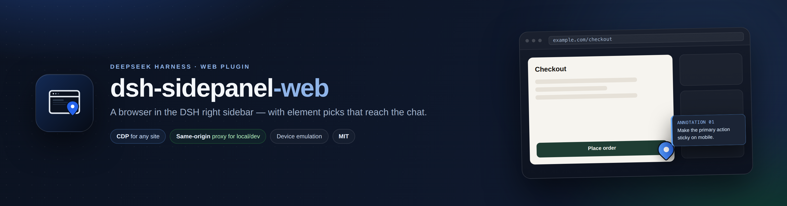
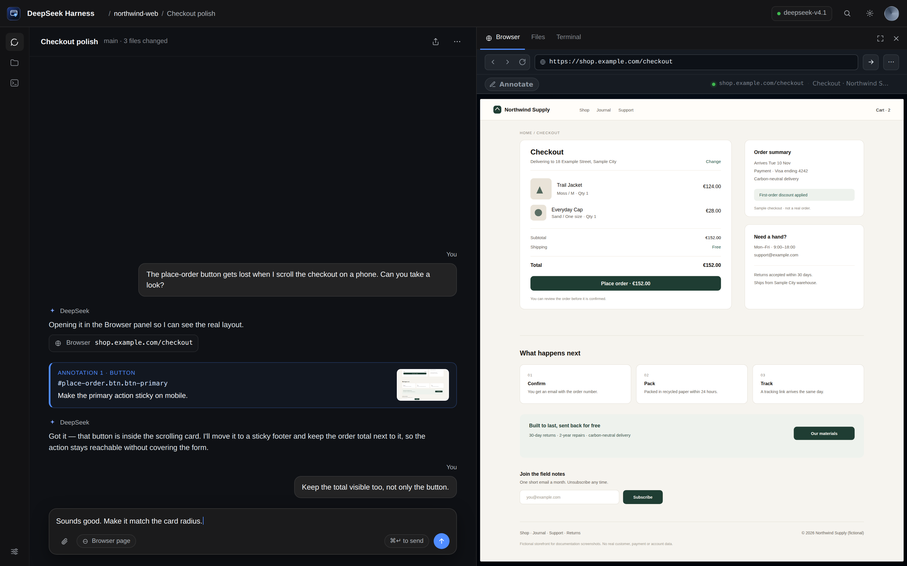
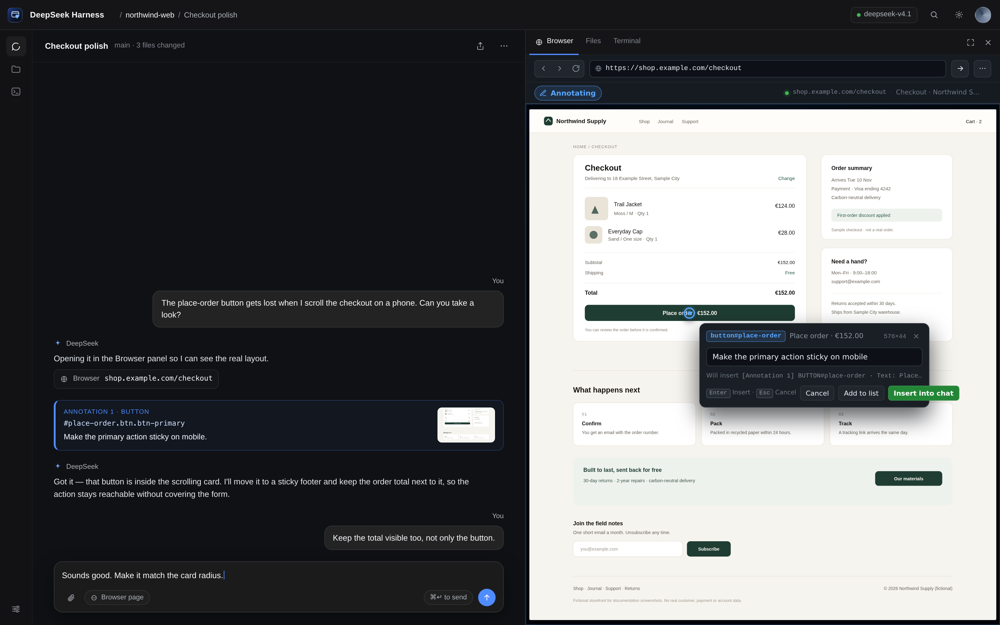
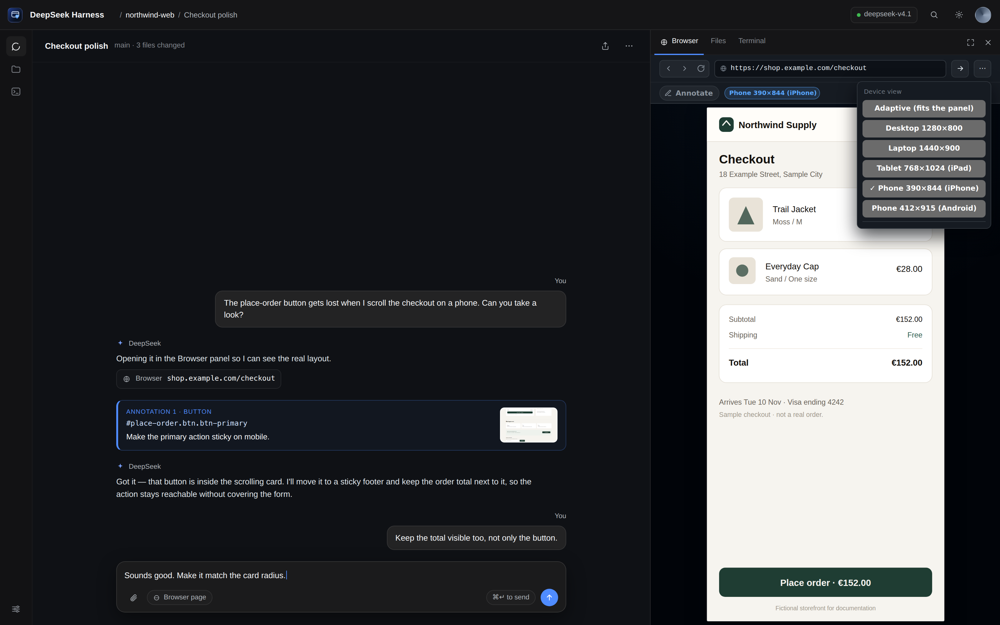
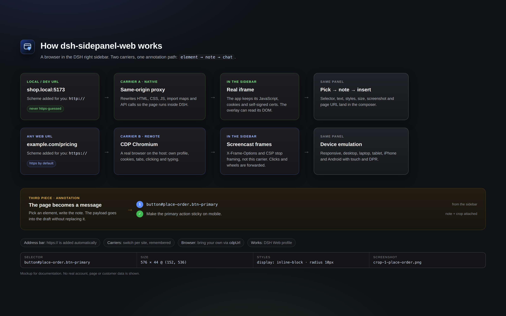

<p align="center">
  
</p>

<p align="center">
  <strong>Un navegador al panell dret de DeepSeek Harness Web, amb anotacions que arriben al xat.</strong>
</p>

<p align="center">
  <a href="https://github.com/AleixRocal/dsh-sidepanel-web/actions/workflows/ci.yml"></a>
  <a href="https://github.com/AleixRocal/dsh-sidepanel-web/releases"></a>
  <a href="LICENSE"></a>
  
  
</p>

<p align="center">
  <a href="README.md">English</a> · <strong>Català</strong>
</p>

`dsh-sidepanel-web` afegeix una pestanya **Navegador** al panell dret de DSH. Obre una pàgina al costat de la conversa, tria l'element del qual estàs parlant, escriu una nota i envia-la al composer amb el selector, els estils, la mida i una captura retallada.

> [!TIP]
> **Un panell, dos portadors.** Les pàgines locals/dev passen per un proxy same-origin i continuen sent totalment interactives. Qualsevol pàgina pública es renderitza amb un Chromium real via CDP, així que `X-Frame-Options` i CSP no l'aturen. El panell tria el portador segons la URL i el commutador és a un clic.



<p align="center"><em>Captures mockup: la botiga, la conversa i les URL són inventades. No mostren cap compte ni dada de client real.</em></p>

## Índex

- [Per què](#per-què)
- [Funcionalitats](#funcionalitats)
- [Inici ràpid](#inici-ràpid)
- [Captures](#captures)
- [Ús](#ús)
- [Configuració](#configuració)
- [Com funciona](#com-funciona)
- [Preguntes freqüents](#preguntes-freqüents)
- [Privacitat de les captures](#privacitat-de-les-captures)
- [Seguretat](#seguretat)
- [Limitacions](#limitacions)
- [Desenvolupament](#desenvolupament)
- [Canvis](CHANGELOG.md)
- [Market](#market)
- [Contribuir](#contribuir)
- [Crèdits](#crèdits)
- [Llicència](#llicència)

## Per què

Parlar d'una pàgina web amb un agent normalment vol dir captures, coordenades i descripcions vagues. Aquest panell manté la pàgina al costat de la conversa i converteix «aquest botó d'aquí» en una dada precisa: selector, text, classes, estils, posició i una captura retallada.

Funciona en les dues direccions:

- **Les pàgines que estàs construint** — `localhost`, `*.local`, IP privades, servidors de desenvolupament amb certificats autosignats — on el host de DSH pot arribar a la pàgina encara que el teu navegador no pugui. Passen pel proxy same-origin i es poden anotar.
- **Qualsevol pàgina pública** — documentació, un competidor, un issue tracker, un staging amb login. Les renderitza un Chromium real al host via CDP; `X-Frame-Options` i CSP no les aturen.

## Funcionalitats

**Navegació i portadors**

- **Esquema automàtic a la barra d'adreces.** Escriu `example.com` i s'obre `https://example.com/`; escriu `shop.local:5173`, `127.0.0.1:5173` o `192.168.1.20:8080` i fa servir `http://`. Els esquemes que no són web (`mailto:`, `file:`, `javascript:`, `data:`) es rebutgen.
- **Dos portadors, intercanviables per lloc.** La vista nativa té un botó *Vista remota (CDP)*; la vista CDP ofereix *Vista nativa (proxy)* per a hosts locals. La tria es recorda per origen.
- **Els enllaços del xat arriben aquí.** La pestanya registra `kind: "browser"`, així que l'opció «obre l'enllaç a la barra lateral» obre aquest navegador anotable; `params.url` es navega en arribar.
- **Porta el teu navegador.** Apunta `cdpUrl`/`wsUrl` a qualsevol Chrome amb `--remote-debugging-port`, deixa que el plugin en descobreixi un o deixa que n'arrenqui un amb perfil persistent.

**El portador natiu (local/dev)**

- HTML, CSS, JS, imatges i crides API es queden a l'origen de DSH gràcies al proxy reescriptor.
- Un petit shim manté `fetch`, `XMLHttpRequest`, `history.pushState`/`replaceState` i `window.open` al proxy.
- S'accepten certificats autosignats per a hosts locals.
- Les URL de `<script type="importmap">` (imports i scopes) es reescriuen perquè les apps de mòduls ES continuïn carregant.
- Només es reescriuen atributs que són URL de debò: noms d'acció com `data-action="family"` no es toquen.
- Les galetes es guarden en un pot per origen; la galeta de sessió de DSH no s'envia mai al destí.

**El portador remot (pàgines públiques)**

- Un Chromium real renderitza la pàgina al host i n'emet fotogrames; clics, roda, teclat i arrossegaments es reenvien.
- Funciona en llocs que prohibeixen ser incrustats (`X-Frame-Options`/`frame-ancestors`, CSP).
- Els logins i galetes són els del perfil de navegador que li indiques.

**Anotacions i dispositius**

- Inspector en passar el ratolí: `tag#id.class  240×44  [role]`.
- Selecció d'element amb selector, text, classes, estils, posició, fragment HTML i URL de la pàgina.
- Pins numerats, notes i una captura retallada per selector.
- Lliurament al composer amb `InputActions.insertText`, sense substituir l'esborrany.
- Emulació de dispositiu: adaptatiu (s'ajusta al panell), escriptori 1280×800, portàtil 1440×900, tauleta 768×1024 (UA d'iPad), mòbil 390×844 (UA d'iPhone) i Android 412×915 — amb tàctil real i `devicePixelRatio` corresponent.
- UI en anglès i castellà via `ctx.locale`; altres idiomes cauen a l'anglès.

## Inici ràpid

### Requisits

- DSH **0.2.1-rc.2** o superior, per sota de `0.3.0` (perfil Web).
- Node.js **22.19+**.
- Un navegador basat en Chromium al host. El plugin detecta Chrome/Chromium; la caché de Chromium de Playwright també serveix.

### Instal·lació

```bash
# des de GitHub
dsh plugin --profile web add github:AleixRocal/dsh-sidepanel-web

# o des d'un clon local, mentre desenvolupes
git clone https://github.com/AleixRocal/dsh-sidepanel-web
dsh plugin --profile web add link:/ruta/absoluta/a/dsh-sidepanel-web
```

Reinicia `dsh web` un cop i refresca la GUI. La pestanya **Navegador** apareix a la guia del panell dret.

### Primera pàgina

1. Desplega el panell dret i tria **Navegador**.
2. Escriu `example.com` i prem **Enter**. El panell obre `https://example.com/`; l'esquema s'afegeix sol.
3. Clica **Annotate**, passa el ratolí, clica un element, escriu la nota i tria **Insert**.

> [!NOTE]
> Si no troba cap navegador als ports CDP habituals, el plugin arrenca un Chromium headless dedicat amb perfil persistent. Només cal `chromePath` si la detecció automàtica no troba el binari.

### Fer servir el teu navegador

Per reutilitzar el navegador que ja fas servir (mateixes galetes i logins), exposa el seu port CDP i apunta-hi el plugin:

```sh
google-chrome --remote-debugging-port=9222 --user-data-dir="$HOME/.config/chrome-dsh" &
```

```yaml
- id: dsh-sidepanel-web
  config:
    cdpUrl: http://127.0.0.1:9222   # o wsUrl: ws://127.0.0.1:9222/devtools/browser/…
```

Chrome 136+ no deixa consultar `/json/version` al perfil per defecte, d'aquí el `--user-data-dir` separat. Sense `cdpUrl`/`wsUrl`, el plugin prova 9222–9225 i 9333, després `~/.local/state/dsh-sidepanel-web/browser.json` i finalment el fitxer del pont ego.

## Captures

| | |
| --- | --- |
|  |  |
| **Tria, nota, envia.** El pin cau sobre l'element i la targeta prepara el payload del composer. | **Emulació de dispositiu.** Escriptori, portàtil, tauleta, iPhone i Android amb tàctil i DPR. |



Totes les captures són mockups generats amb [`test/preview/shell.html`](test/preview/shell.html) i [`test/preview/diagram.html`](test/preview/diagram.html): el panell és el client real, la botiga és la **Northwind Supply** fictícia al domini reservat `example.com`, i no s'hi fa servir cap compte, pàgina ni dada de client real. Vegeu [Privacitat de les captures](#privacitat-de-les-captures).

## Ús

1. Obre una sessió, desplega el panell dret i tria **Navegador**.
2. Escriu una URL a la barra d'adreces.
   - `example.com` → `https://example.com/` (esquema afegit).
   - `localhost:3000`, `shop.local`, `192.168.1.20:8080` → `http://` perquè els servidors de desenvolupament no solen tenir TLS.
   - **Host local/dev**: la pàgina passa pel proxy de DSH i és totalment interactiva.
   - **Host públic**: la renderitza el Chromium del host i s'emet al panell. Fes servir **Vista nativa** només per a llocs locals.
3. Clica **Annotate** i passa el ratolí. L'inspector mostra el tipus i la mida de l'element.
4. Clica l'element, escriu la nota i tria **Add to list**.
5. Tria **Insert** per posar les anotacions al composer; envia el missatge.

| URL | Portador | Per què |
| --- | --- | --- |
| `example.com`, qualsevol lloc públic | Screencast CDP | Funciona encara que el lloc enviï `X-Frame-Options`/CSP. |
| `localhost`, `*.local`, IP privades/loopback/link-local | Proxy same-origin | Render natiu, accés al DOM i anotació sense screencast. |

Cada anotació té aquesta forma:

```text
[Annotation 1] button#save.primary
· Selector: #save
· Text: Save changes
· Styles: display=inline-block; position=static; color=rgb(255, 255, 255); …
· Position: 132×40 @ (24, 680)
· Page: Settings https://localhost:5173/settings
· Note: Make this primary action sticky on mobile
· Screenshot: ~/.dsh/data/dsh-sidepanel-web/crops/…
```

## Configuració

Opcions al patch del perfil, a la fila del plugin:

```yaml
# ~/.dsh/profiles/web/cordis.patch.yml
- id: dsh-sidepanel-web
  config:
    chromePath: /ruta/al/chrome
    headless: true
```

| Clau | Valor per defecte | Significat |
| --- | --- | --- |
| `chromePath` | autodetecció | Ruta absoluta a un navegador basat en Chromium. |
| `headless` | `true` | Arrenca el navegador del host sense finestra. |
| `autoLaunch` | `true` | Arrenca un navegador quan no hi ha cap endpoint CDP. |
| `wsUrl` | buit | Endpoint CDP explícit (`ws://127.0.0.1:port/devtools/browser/…`). |
| `cdpUrl` | buit | Endpoint HTTP de depuració d'un navegador existent, p. ex. `http://127.0.0.1:9222`; es resol amb `/json/version`. |
| `profileDir` | `~/.local/share/dsh-sidepanel-web/profile` | Directori del perfil (persistent: els logins sobreviuen reinicis). |
| `homeUrl` | `https://www.deepseek.com` | Primera pàgina quan arrenca el navegador. |
| `device` | `responsive` | Preset d'emulació: `responsive`, `desktop`, `laptop`, `tablet`, `mobile`, `android`. |
| `pollMs` | `1200` | Interval de captura per al mode d'stream antic. |
| `quality` | `82` | Qualitat JPEG per al mode d'stream antic. |
| `streamMode` | `screencast` | `screencast` o `poll` (mode d'stream antic). |
| `streamFps` | `15` | Límit de fotogrames per al mode d'stream antic. |

## Com funciona

```text
DSH Web GUI
  └─ Pestanya Navegador (sidebar.right.pane.tab)
       ├─ Portador A · natiu (local/dev)
       │    iframe del proxy ──► /api/sidepanel-web/p/<origen>/<camí>
       │                         └─ proxy reescriptor (HTML/CSS/JS/API)
       │                              └─ overlay: tria → nota → captura
       └─ Portador B · remot (qualsevol pàgina)
            Chromium CDP (host) ──► fotogrames + entrada reenviada
                 └─ mateix panell, mateixa anotació

  anotacions ──► composer (InputActions.insertText)
```

- **Meitat host** (`lib/index.js`, `lib/service.js`, `lib/cdp.js`, `lib/launcher.js`): rutes, cicle de vida de Chromium, CDP, captures i retalls.
- **Proxy** (`lib/proxy.js`): descarrega pàgines locals/dev, reescriu URL, injecta el shim i l'overlay, i manté un pot de galetes per origen.
- **Pàgina/overlay** (`lib/page.js`): portador de pàgina renderitzada i overlay d'anotació.
- **Regles d'URL** (`lib/url.js`): detecció d'esquema compartida amb el client (mirall dins `lib/client.js`, verificat per `test/url-smoke.mjs`).
- **Meitat client** (`lib/client.js`): pestanya, barra d'adreces, portadors natiu/remot, targeta de nota, inserció al composer i diccionaris EN/ES.

La recerca completa sobre la integració amb DSH Web (slots, registre de pestanyes, portadors, descoberta de navegador) és a [`docs/browser-integration.md`](docs/browser-integration.md).

## Preguntes freqüents

<details>
<summary><strong>He escrit <code>example.com</code> i s'ha obert <code>https://example.com/</code>. Puc forçar <code>http://</code>?</strong></summary>

Sí: escriu l'esquema explícitament (`http://example.com`). Els hosts locals/dev (`localhost`, `*.local`, IP privades, loopback i link-local) ja fan servir `http://` per defecte perquè els servidors de desenvolupament no solen tenir TLS. Els esquemes que no són web es rebutgen.
</details>

<details>
<summary><strong>La pàgina pública dona error de connexió o no carrega.</strong></summary>

Les pàgines públiques van pel portador CDP, no per un iframe, així que `X-Frame-Options` no n'és la causa. Comprova que el Chromium del host estigui engegat i accessible (`cdpUrl`/`wsUrl` o l'autoarrencada) i que el host tingui xarxa cap al lloc. La línia d'estat del panell indica l'error CDP.
</details>

<details>
<summary><strong>La pàgina local es veu en blanc a la vista nativa.</strong></summary>

El proxy reescriptor cobreix la majoria d'apps, però les WebSockets/HMR no es proxien i algunes apps amb molt JavaScript necessiten un navegador real. Fes servir **Vista remota (CDP)** per a aquell lloc; la tria es recorda per origen.
</details>

<details>
<summary><strong>Chrome 136+ no exposa <code>/json/version</code>.</strong></summary>

Arrenca'l amb un perfil separat: `--user-data-dir="$HOME/.config/chrome-dsh"`. Des de Chrome 136 el perfil per defecte està protegit de CDP.
</details>

<details>
<summary><strong>On es guarden les galetes i els logins?</strong></summary>

El Chromium propi del plugin fa servir el `profileDir` persistent (`~/.local/share/dsh-sidepanel-web/profile` per defecte). Si l'apuntes al teu navegador via `cdpUrl`/`wsUrl`, qui guarda el perfil i les galetes és aquell navegador.
</details>

<details>
<summary><strong>Funciona a DSH Desktop?</strong></summary>

No. És un plugin del perfil Web; DSH Desktop fa servir un `<webview>` d'Electron i un perfil diferent.
</details>

<details>
<summary><strong>Puc anotar iframes cross-origin o shadow DOM tancat?</strong></summary>

Només el seu contenidor. L'overlay no pot travessar un iframe cross-origin ni un shadow root tancat.
</details>

<details>
<summary><strong>Com es generen les captures? S'hi fa servir cap dada real?</strong></summary>

Amb `npm run mockups`, a partir del client real i un backend mock. Totes les imatges fan servir contingut inventat (botiga fictícia, `example.com` reservat, conversa inventada); no es captura cap finestra de DSH, compte, client, ruta ni token real. Vegeu [Privacitat de les captures](#privacitat-de-les-captures).
</details>

## Privacitat de les captures

Les captures formen part del lliurable, així que tenen una regla dura: **cap dada d'usuari real**.

- El panell és el `lib/client.js` real; el voltant (conversa, espai de treball, sessió) és HTML estàtic a [`test/preview/shell.html`](test/preview/shell.html).
- La botiga és **Northwind Supply**, una botiga fictícia al domini reservat `example.com`.
- Cap finestra de DSH, compte, pàgina, client, ruta ni token real apareix a cap imatge.
- [`screenshots.json`](screenshots.json) declara les quatre imatges de botiga per als marketplaces de plugins.
- Es regeneren amb `npm run mockups`; el banner es renderitza des de [`test/preview/banner.html`](test/preview/banner.html).

## Seguretat

- Totes les rutes del host criden `connection.requestRejection(req)`; el servidor web està lligat a loopback.
- El proxy reescriptor només accepta **hosts locals/dev** (localhost, `*.local`, rangs privats, loopback i link-local). Les URL públiques es rebutgen i les gestiona el portador CDP.
- L'iframe natiu corre amb sandbox (`allow-scripts allow-forms allow-same-origin allow-popups` per a pàgines locals). `allow-same-origin` és necessari perquè el document del proxy conservi galetes i API; també vol dir que una pàgina proxificada comparteix l'origen de DSH. Només proxifica pàgines de confiança.
- El navegador del host fa servir un perfil dedicat i ignora errors de certificat dels servidors locals autosignats. El portador CDP té les capacitats del navegador al qual l'apuntes.
- El text de les anotacions i el contingut de la pàgina són dades no confiables per a l'agent.
- Reporta vulnerabilitats en privat via [SECURITY.md](SECURITY.md); no obris un issue públic.

## Limitacions

- **Només Web.** DSH Desktop fa servir `<webview>` d'Electron i un altre perfil; aquest plugin no el substitueix.
- **El proxy és només local/dev.** Els llocs públics no es proxien; van al navegador CDP.
- **WebSocket/HMR no es proxien** al portador natiu. Els servidors de desenvolupament serveixen la pàgina, però el hot reload pot no funcionar; canvia a la vista CDP.
- **Galetes** al portador natiu viuen en un pot per origen; alguns fluxos de login poden fallar. El portador CDP fa servir el perfil del navegador.
- **Iframes cross-origin i shadow DOM tancat** no es poden anotar; només el contenidor.
- **Els retalls** es fan per selector a la pàgina del host; un estat dinàmic pot diferir del fotograma que vas veure.
- **La latència CDP** depèn del host i de la pàgina; el screencast té un límit de 15 fps per defecte.
- **Alfa:** les API i el comportament poden canviar.

## Desenvolupament

```text
lib/
  index.js        plugin host: rutes, settings, registre del proxy
  service.js      servei CDP: estat, navegació, captures, elementAt, retall
  cdp.js          client CDP sense dependències
  launcher.js     descoberta/arrencada de Chromium (container-safe, certificats)
  page.js         portador de pàgina + overlay d'anotació
  proxy.js        proxy invers reescriptor per a local/dev
  url.js          normalització d'adreces (mirall a client.js)
  client.js       pestanya, portadors, pont de l'overlay, composer
assets/           icon.svg, icon.png, icon-180.png, banner.png, screenshots/
test/             smoke tests i harness de preview/mockups
docs/             recerca de la integració amb DSH Web
```

```bash
npm run check          # node --check de tots els fitxers font
npm test               # regles d'URL + proves de reescriptura del proxy
npm run smoke          # smoke test del host amb CDP (necessita Chromium)
npm run mockups        # regenera assets/banner.png i assets/screenshots
dsh plugin --profile web add link:$PWD
```

Les notes de versió són a [`CHANGELOG.md`](CHANGELOG.md).

El harness de preview renderitza el `lib/client.js` real amb un backend mock:

```bash
node test/preview/server.mjs
# http://127.0.0.1:7788/harness.html?state=ready&w=360&h=780
```

Vegeu [`test/preview/README.md`](test/preview/README.md) per a tots els estats, la shell de finestra completa i el pipeline de mockups.

## Market

El registre [awesome-dsh-plugin](https://github.com/awesome-dsh-plugin/awesome-dsh-plugin) és la font del market. Estat del lliurament:

- [x] Repo públic i topic `dsh-plugin`.
- [x] `package.json` declara `dsh.bundle` i inclou [`cordis.patch.yml`](cordis.patch.yml).
- [x] Icona raster a `assets/icon-180.png` i captures a [`screenshots.json`](screenshots.json).
- [x] Entrada esborrany a [`market/entry.yml`](market/entry.yml).
- [x] PR oberta: [awesome-dsh-plugin#12641](https://github.com/awesome-dsh-plugin/awesome-dsh-plugin/pull/12641) — un fitxer, `data/plugins/AleixRocal__dsh-sidepanel-web.yml`.

El registre valida l'edat del repo (≥ 1 dia) i torna a executar els gates antics automàticament, així que una PR primerenca queda retinguda, no rebutjada. Aquest repo va fer el primer dia el 2026-11-06 a les 15:45 UTC; fins llavors el gate pot reportar el check d'edat com a pendent.

## Contribuir

Les contribucions són benvingudes: errors, arreglos de portadors, documentació i millores dels mockups. Comença per [CONTRIBUTING.md](CONTRIBUTING.md), executa `npm run check` i `npm test`, i llegeix la regla de privacitat de les captures abans d'afegir imatges. Aquest projecte segueix el [Codi de conducta](CODE_OF_CONDUCT.md). Els reports de seguretat van per [SECURITY.md](SECURITY.md), no per issues públics.

## Crèdits

Fork de [`zengxiaolou/dsh-annotate-browser`](https://github.com/zengxiaolou/dsh-annotate-browser) (MIT): el client CDP, el launcher, el selector d'elements i el flux de retall hi van començar. Aquest fork afegeix la integració oficial al panell dret, el proxy reescriptor local/dev, el commutador de portadors, l'overlay d'anotació, l'emulació de dispositiu, la UI EN/ES i el lliurament al composer.

## Llicència

MIT. Vegeu [LICENSE](LICENSE); el copyright original es conserva.

---

<p align="center"><a href="README.md">English</a> · Català · <a href="#índex">Torna a dalt ↑</a></p>
