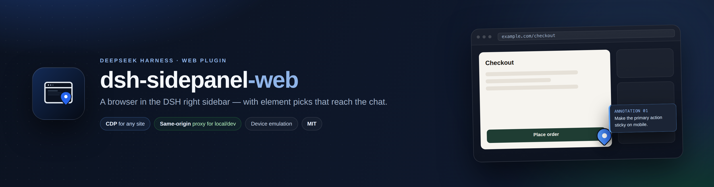

<p align="center">
  
</p>

<p align="center">
  <strong>A browser in the right sidebar of DeepSeek Harness Web — with element picks that reach the chat.</strong>
</p>

<p align="center">
  <a href="https://github.com/AleixRocal/dsh-sidepanel-web/actions/workflows/ci.yml"></a>
  <a href="https://github.com/AleixRocal/dsh-sidepanel-web/releases"></a>
  <a href="https://www.npmjs.com/package/dsh-sidepanel-web"></a>
  <a href="https://github.com/AleixRocal/dsh-sidepanel-web/blob/main/LICENSE"></a>
  
  
  <a href="https://github.com/awesome-dsh-plugin/awesome-dsh-plugin/pull/12641"></a>
</p>

<p align="center">
  English · <a href="https://github.com/AleixRocal/dsh-sidepanel-web/blob/main/README.ca.md">Català</a>
</p>

`dsh-sidepanel-web` adds a **Browser** tab to the DSH right sidebar. Open a page next to the conversation, pick the element you are talking about, write a note, and send it to the composer with its selector, styles, size and one annotated screenshot attached.

> [!TIP]
> **One panel, two carriers.** Local/dev pages go through a same-origin proxy and stay fully interactive. Any public page is rendered by a real Chromium over CDP, so `X-Frame-Options` and CSP cannot block it. The panel picks the carrier from the URL; the switch is one click away.


<p align="center"><em>Mockup screenshots: the storefront, conversation and URLs are invented. No real account or customer data is shown.</em></p>

## Table of contents

- [Why](#why)
- [Features](#features)
- [Quick start](#quick-start)
- [Screenshots](#screenshots)
- [Screenshots and privacy](#screenshots-and-privacy)
- [Usage](#usage)
- [Configuration](#configuration)
- [How it works](#how-it-works)
- [FAQ](#faq)
- [Security](#security)
- [Known limitations](#known-limitations)
- [Development](#development)
- [Changelog](https://github.com/AleixRocal/dsh-sidepanel-web/blob/main/CHANGELOG.md)
- [Market](#market)
- [Contributing](#contributing)
- [Credits](#credits)
- [License](#license)

## Why

Talking about a web page with an agent usually means screenshots, coordinates and vague descriptions. This panel keeps the page next to the conversation and turns “this button here” into a precise payload: selector, text, classes, styles, position and a cropped screenshot.

It works in both directions:

- **The pages you are building** — `localhost`, `*.local`, private IPs, dev servers with self-signed certificates — where the DSH host can reach the page even when your browser cannot. These go through the same-origin proxy and stay fully interactive and annotatable.
- **Any public page** — docs, a competitor, an issue tracker, a staging site behind a login. These are rendered by a real Chromium on the host over CDP; `X-Frame-Options` and CSP cannot stop them.

## Features

**Navigation and carriers**

- **Automatic address-bar scheme.** Type `example.com` and the panel opens `https://example.com/`; type `shop.local:5173`, `127.0.0.1:5173` or `192.168.1.20:8080` and it uses `http://` instead. Non-web schemes (`mailto:`, `file:`, `javascript:`, `data:`) are refused instead of being turned into a website.
- **Two carriers, switchable per site.** The native view has a *Remote view (CDP)* button; the CDP view offers *Native view (proxy)* for local hosts and *Force native view (unsafe)* for any other origin. The choice is remembered per origin.
- **Chat links land here.** The tab registers `kind: "browser"`, so the chat's “open link in sidebar” preference opens this annotated browser; `params.url` is navigated on arrival.
- **Bring your own browser.** Point `cdpUrl`/`wsUrl` at any Chrome started with `--remote-debugging-port`, or let the plugin discover one, or let it launch its own with a persistent profile.

**The native carrier (local/dev)**

- HTML, CSS, JS, images and API requests stay on the DSH origin through a rewriting proxy.
- A small shim keeps `fetch`, `XMLHttpRequest`, `history.pushState`/`replaceState` and `window.open` on the proxy.
- Self-signed certificates are accepted for local hosts.
- `<script type="importmap">` URLs (imports and scopes) are rewritten, so ES-module apps keep loading.
- Only real URL attributes are rewritten: `data-action="family"`-style action names stay untouched.
- Cookies are kept in a per-origin host jar; DSH's own session cookie is never forwarded.

**The remote carrier (public pages)**

- A real Chromium renders the page on the host and streams frames; clicks, wheel, typing and drags are forwarded.
- Works on sites that refuse framing (`X-Frame-Options`/`frame-ancestors`, CSP).
- Your logins and cookies come from the browser profile you point it at.

**Annotations and devices**

- Hover inspector: `tag#id.class  240×44  [role]`.
- Element pick with selector, text, classes, styles, position, HTML excerpt and page URL.
- Numbered pins, notes, and a crop captured by selector.
- Composer hand-off with `InputActions.insertText`, so the draft is not replaced.
- **One annotated image rides along.** Insert attaches a single viewport screenshot with every pick pinned, so the chat shows the annotated page instead of tiny per-element crops (DSH caps a lone image at 240px and renders several images as 64px squares). The text still carries each selector, DOM excerpt, styles, position and crop path.
- **Esc leaves annotate mode** from the page or the toolbar; an open note card closes first.
- Device emulation: responsive (fits the panel), desktop 1280×800, laptop 1440×900, tablet 768×1024 (iPad UA), phone 390×844 (iPhone UA) and Android 412×915 — real touch emulation and matching `devicePixelRatio`.
- English and Spanish UI through `ctx.locale`; other locales fall back to English.

## Quick start

### Requirements

- DSH **0.2.1-rc.2** or newer, below `0.3.0` (Web profile).
- Node.js **22.19+**.
- A Chromium-based browser on the host. The plugin auto-detects Chrome/Chromium; the Playwright Chromium cache also works.

### Install

```bash
# from npm
dsh plugin --profile web add dsh-sidepanel-web

# from GitHub
dsh plugin --profile web add github:AleixRocal/dsh-sidepanel-web

# or from a local clone, while developing
git clone https://github.com/AleixRocal/dsh-sidepanel-web
dsh plugin --profile web add link:/absolute/path/to/dsh-sidepanel-web
```

Restart `dsh web` once and refresh the GUI. The **Browser** tab appears in the right-sidebar guide.

### First page

1. Expand the right sidebar and choose **Browser**.
2. Type `example.com` and press **Enter**. The panel opens `https://example.com/`; the scheme is added for you.
3. Click **Annotate**, hover the page, click an element, write the note and choose **Insert**.

> [!NOTE]
> If no browser is found on the usual CDP ports, the plugin launches a dedicated headless Chromium with a persistent profile. Set `chromePath` only when auto-detection misses your binary.

### Use your own browser

To reuse the browser you already run (same cookies and logins), expose its CDP port and point the plugin at it — no separate install:

```sh
google-chrome --remote-debugging-port=9222 --user-data-dir="$HOME/.config/chrome-dsh" &
```

```yaml
- id: dsh-sidepanel-web
  config:
    cdpUrl: http://127.0.0.1:9222   # or wsUrl: ws://127.0.0.1:9222/devtools/browser/…
```

Chrome 136+ refuses `/json/version` on the default profile, hence the separate `--user-data-dir`. Without `cdpUrl`/`wsUrl` the plugin probes 9222–9225 and 9333, then `~/.local/state/dsh-sidepanel-web/browser.json`, then the ego bridge file.

## Screenshots

| | |
| --- | --- |
|  |  |
| **Pick, note, send.** The pin lands on the element and the note card prepares the composer payload. | **Device emulation.** Desktop, laptop, tablet, iPhone and Android with touch and DPR. |


<p align="center"><em>The diagram: a local/dev page through the same-origin proxy, a public page through CDP, and both feeding the same annotation payload.</em></p>

All screenshots are mockups generated from [`test/preview/shell.html`](https://github.com/AleixRocal/dsh-sidepanel-web/blob/main/test/preview/shell.html) and [`test/preview/diagram.html`](https://github.com/AleixRocal/dsh-sidepanel-web/blob/main/test/preview/diagram.html): the panel is the real client, the storefront is the fictional **Northwind Supply** on the reserved `example.com` domain, and no real account, page or customer data is used. See [Screenshots and privacy](#screenshots-and-privacy).

## Usage

1. Open a session, expand the right sidebar, and choose **Browser**.
2. Enter a URL in the address bar.
   - `example.com` → `https://example.com/` (scheme added for you).
   - `localhost:3000`, `shop.local`, `192.168.1.20:8080` → `http://` is used for local/dev hosts, which rarely have TLS.
   - **Local/dev host**: the page is proxied through DSH and is fully interactive.
   - **Public host**: the page is rendered by the host Chromium and streamed into the panel. Use **Native view** only for local sites.
3. Click **Annotate** (or the annotate toggle) and hover the page. The inspector shows the element type and size.
4. Click the element, write the note, and choose **Add to list**.
5. Choose **Insert** to place the annotations in the composer; send the message.

| URL | Carrier | Why |
| --- | --- | --- |
| `example.com`, any public site | CDP screencast | Works even when the site sends `X-Frame-Options`/CSP. |
| `localhost`, `*.local`, private/loopback/link-local IPs | Same-origin proxy | Native rendering, DOM access and annotation without a screencast. |

Each annotation looks like this:

```text
[Annotation 1] button#save.primary
· Selector: #save
· Text: Save changes
· Styles: display=inline-block; position=static; color=rgb(255, 255, 255); …
· Position: 132×40 @ (24, 680)
· Page: Settings https://localhost:5173/settings
· Note: Make this primary action sticky on mobile
· Screenshot: ~/.dsh/data/dsh-sidepanel-web/crops/…
```

## Configuration

Set options in the profile patch, under the plugin's row:

```yaml
# ~/.dsh/profiles/web/cordis.patch.yml
- id: dsh-sidepanel-web
  config:
    chromePath: /path/to/chrome
    headless: true
```

| Key | Default | Meaning |
| --- | --- | --- |
| `chromePath` | auto-detect | Absolute path to a Chromium-based browser. |
| `headless` | `true` | Launch the host browser without a window. |
| `autoLaunch` | `true` | Start a browser when no CDP endpoint is available. |
| `wsUrl` | empty | Explicit CDP endpoint (`ws://127.0.0.1:port/devtools/browser/…`). |
| `cdpUrl` | empty | HTTP debugging endpoint of an existing browser, e.g. `http://127.0.0.1:9222`; resolved through `/json/version`. |
| `profileDir` | `~/.local/share/dsh-sidepanel-web/profile` | Browser profile directory (persistent: logins survive restarts). |
| `homeUrl` | `https://www.deepseek.com` | First page when the browser starts. |
| `device` | `responsive` | Emulation preset: `responsive`, `desktop`, `laptop`, `tablet`, `mobile`, `android`. |
| `pollMs` | `1200` | Screenshot polling interval for the legacy stream mode. |
| `quality` | `82` | JPEG quality for the legacy stream mode. |
| `streamMode` | `screencast` | `screencast` or `poll` (legacy stream mode). |
| `streamFps` | `15` | Frame-rate cap for the legacy stream mode. |

## How it works

```text
DSH Web GUI
  └─ Browser tab (sidebar.right.pane.tab)
       ├─ Carrier A · native (local/dev)
       │    proxy iframe ──► /api/sidepanel-web/p/<origin>/<path>
       │                         └─ rewriting proxy (HTML/CSS/JS/API)
       │                              └─ overlay: element pick → note → crop
       └─ Carrier B · remote (any page)
            CDP Chromium (host) ──► screencast frames + forwarded input
                 └─ same panel, same annotation flow

  annotations ──► composer (InputActions.insertText)
```

- **Host half** (`lib/index.js`, `lib/service.js`, `lib/cdp.js`, `lib/launcher.js`): routes, Chromium lifecycle, CDP, screenshots, crops.
- **Proxy** (`lib/proxy.js`): fetches local/dev pages, rewrites URLs, injects the shim and overlay, keeps a per-origin cookie jar.
- **Page/overlay** (`lib/page.js`): rendered-page carrier and the annotation overlay.
- **URL rules** (`lib/url.js`): scheme detection shared with the client (mirrored inside `lib/client.js` and enforced by `test/url-smoke.mjs`).
- **Client half** (`lib/client.js`): the sidebar tab, address bar, native/remote carriers, annotation note card, composer insertion, EN/ES dictionaries.

A deeper write-up of the DSH Web integration (slots, tab registry, carriers, browser discovery) is in [`docs/browser-integration.md`](https://github.com/AleixRocal/dsh-sidepanel-web/blob/main/docs/browser-integration.md) (Catalan).

## FAQ

<details>
<summary><strong>I typed <code>example.com</code> and it opened <code>https://example.com/</code>. Can I force <code>http://</code>?</strong></summary>

Yes — type the scheme explicitly (`http://example.com`). Local/dev hosts (`localhost`, `*.local`, private, loopback and link-local addresses) already default to `http://` because dev servers rarely have TLS. Non-web schemes are rejected.
</details>

<details>
<summary><strong>The public page shows a connection error or refuses to load.</strong></summary>

Public pages use the CDP carrier, not an iframe, so `X-Frame-Options` is not the cause. Check that the host Chromium is running and reachable (`cdpUrl`/`wsUrl` or the auto-launch), and that the host has network access to the site. The panel's status line names the CDP error.
</details>

<details>
<summary><strong>Can I force the native view for a public site?</strong></summary>

Yes, explicitly: open the site, click the **⋯** menu and choose **Force native view (unsafe)**. The choice is remembered per origin, so every later tab to that origin opens in the native carrier, and the page becomes proxied and annotatable like a local one. Only do it for sites you trust: the proxied page shares DSH's origin and can read the panel DOM and call the DSH API with your session. The default policy is unchanged — local/dev goes native, public goes to CDP.
</details>

<details>
<summary><strong>The local page is blank in the native view.</strong></summary>

The rewriting proxy drives most apps, but WebSockets/HMR are not proxied and some heavy JavaScript apps need a real browser. Use **Remote view (CDP)** for that site; the choice is remembered per origin.
</details>

<details>
<summary><strong>Chrome 136+ refuses to expose <code>/json/version</code>.</strong></summary>

Start it with a separate profile: `--user-data-dir="$HOME/.config/chrome-dsh"`. The default profile is protected from CDP since Chrome 136.
</details>

<details>
<summary><strong>Where are cookies and logins stored?</strong></summary>

The plugin's own Chromium uses the persistent `profileDir` (`~/.local/share/dsh-sidepanel-web/profile` by default). When you point it at your own browser via `cdpUrl`/`wsUrl`, that browser keeps its own profile and cookies.
</details>

<details>
<summary><strong>Does it work in DSH Desktop?</strong></summary>

No. This is a Web-profile plugin; DSH Desktop uses an Electron `<webview>` and a different profile.
</details>

<details>
<summary><strong>Can I annotate cross-origin iframes or closed shadow DOM?</strong></summary>

Only their container. The overlay cannot pierce a cross-origin frame or a closed shadow root.
</details>

<details>
<summary><strong>How are the screenshots generated, and is any real data used?</strong></summary>

With `npm run mockups`, from the real client and a mock backend. Every image uses invented content (fictional storefront, reserved `example.com`, invented conversation); no real DSH window, account, customer, file path or token is captured. See [Screenshots and privacy](#screenshots-and-privacy).
</details>

## Screenshots and privacy

Screenshots are part of the deliverable, so they follow a hard rule: **no real user data**.

- The panel is the real `lib/client.js`; the shell around it (conversation, workspace, session) is static HTML in [`test/preview/shell.html`](https://github.com/AleixRocal/dsh-sidepanel-web/blob/main/test/preview/shell.html).
- The storefront is **Northwind Supply**, a fictional shop on the reserved `example.com` domain.
- No real DSH window, account, page, customer, file path or token appears in any image.
- [`screenshots.json`](https://github.com/AleixRocal/dsh-sidepanel-web/blob/main/screenshots.json) declares the four storefront images for plugin marketplaces.
- Regenerate with `npm run mockups`; the banner is rendered from [`test/preview/banner.html`](https://github.com/AleixRocal/dsh-sidepanel-web/blob/main/test/preview/banner.html).

## Security

- Every host route calls `connection.requestRejection(req)`; the web server is loopback-bound.
- The rewriting proxy only accepts **local/dev hosts** (localhost, `*.local`, private, loopback and link-local ranges). Public URLs are refused and handled by the CDP carrier, unless the origin was explicitly forced into the native view.
- The native iframe runs sandboxed (`allow-scripts allow-forms allow-same-origin allow-popups` for local proxy pages). `allow-same-origin` is required for the proxy document to keep its cookies and APIs; it also means a proxied page shares the DSH origin. Only proxy pages you trust.
- **Force native view is an explicit override.** It lets a public origin through the same-origin proxy; that page then shares the DSH origin (DOM, cookies, API calls). The default policy still refuses public hosts. Only force sites you trust.
- The host browser uses a dedicated profile and ignores certificate errors for local self-signed dev servers. The CDP carrier has the capabilities of the browser you point it at.
- Annotation text and page content are treated as untrusted data by the agent.
- Report vulnerabilities privately through [SECURITY.md](https://github.com/AleixRocal/dsh-sidepanel-web/blob/main/SECURITY.md); do not open a public issue.

## Known limitations

- **Web only.** DSH Desktop uses Electron `<webview>` and a different profile; this plugin does not replace it.
- **The proxy is local/dev only by default.** Public sites are not proxied; they run in the CDP browser. **Force native view** is the deliberate per-origin override, with the same-origin warning above.
- **WebSocket/HMR is not proxied** in the native carrier. Dev servers still serve the page, but hot reload may not work; switch to the CDP view for HMR.
- **Cookies** in the native carrier live in a per-origin host jar; some login flows may still fail. The CDP carrier uses the browser's own profile.
- **Cross-origin iframes and closed shadow DOM** cannot be annotated; only their container.
- **Crops** are taken by selector on the host page; a dynamic page state can differ from the frame you saw.
- **The annotated image is a fresh render on the host** (a 1200×800 viewport, or the live CDP page), so state that lived only in the panel — an open modal, a half-filled form — may not appear. The text keeps every pick, its DOM excerpt and its crop path.
- **CDP latency** depends on the host and the page; the screencast caps at 15 fps by default.
- **Alpha:** APIs and behaviour may change.

## Development

```text
lib/
  index.js        host plugin: routes, settings, proxy registration
  service.js      CDP service: status, navigation, screenshots, elementAt, crop
  cdp.js          zero-dependency CDP client
  launcher.js     Chromium discovery/launch (container-safe, cert errors ignored)
  page.js         rendered-page carrier + annotation overlay
  proxy.js        local/dev rewriting reverse proxy
  url.js          address-bar normalisation (mirrored in client.js)
  client.js       sidebar tab, carriers, overlay bridge, composer
assets/           icon.svg, icon.png, icon-180.png, banner.png, screenshots/
test/             smoke tests and the preview/mockup harness
docs/             DSH Web integration research (Catalan)
```

```bash
npm run check          # node --check on every source file
npm test               # URL rules + proxy rewrite smoke tests
npm run test:ui        # Esc + crop-attachment UI regressions (needs Chromium)
npm run smoke          # host CDP smoke test (needs Chromium)
npm run mockups        # re-render assets/banner.png and assets/screenshots
dsh plugin --profile web add link:$PWD
```

Release notes live in [`CHANGELOG.md`](https://github.com/AleixRocal/dsh-sidepanel-web/blob/main/CHANGELOG.md).

The preview harness renders the real `lib/client.js` with a mock backend:

```bash
node test/preview/server.mjs
# http://127.0.0.1:7788/harness.html?state=ready&w=360&h=780
```

See [`test/preview/README.md`](https://github.com/AleixRocal/dsh-sidepanel-web/blob/main/test/preview/README.md) for every state, the full-window shell, the behaviour test and the mockup pipeline.

## Market

The [awesome-dsh-plugin](https://github.com/awesome-dsh-plugin/awesome-dsh-plugin) registry is the market source. Submission state:

- [x] Repository is public and the `dsh-plugin` topic is set.
- [x] `package.json` declares `dsh.bundle` and ships [`cordis.patch.yml`](https://github.com/AleixRocal/dsh-sidepanel-web/blob/main/cordis.patch.yml).
- [x] Raster icon at `assets/icon-180.png` and storefront screenshots in [`screenshots.json`](https://github.com/AleixRocal/dsh-sidepanel-web/blob/main/screenshots.json).
- [x] Entry drafted at [`market/entry.yml`](https://github.com/AleixRocal/dsh-sidepanel-web/blob/main/market/entry.yml).
- [x] Pull request opened: [awesome-dsh-plugin#12641](https://github.com/awesome-dsh-plugin/awesome-dsh-plugin/pull/12641) — one file, `data/plugins/AleixRocal__dsh-sidepanel-web.yml`.

The registry validates the repository age (≥ 1 day) and re-runs stale gates automatically. The current gate verdict is exactly that: **0.8 / 1 day**, with no other problem. It clears by itself once the repository reaches 24 h at **2026-11-06 15:45 UTC**; no resubmission is needed.

## Contributing

Contributions are welcome: bug reports, carrier fixes, documentation and mockup improvements. Start with [CONTRIBUTING.md](https://github.com/AleixRocal/dsh-sidepanel-web/blob/main/CONTRIBUTING.md), run `npm run check` and `npm test`, and read the screenshot privacy rule before adding images. This project follows the [Code of Conduct](https://github.com/AleixRocal/dsh-sidepanel-web/blob/main/CODE_OF_CONDUCT.md). Security reports go through [SECURITY.md](https://github.com/AleixRocal/dsh-sidepanel-web/blob/main/SECURITY.md), not public issues.

## Credits

Forked from [`zengxiaolou/dsh-annotate-browser`](https://github.com/zengxiaolou/dsh-annotate-browser) (MIT): the CDP client, launcher, element picker and crop flow started there. This fork adds the official right-sidebar integration, the local/dev rewriting proxy, the two-carrier switch, annotation overlay, device emulation, EN/ES copy and the composer hand-off.

## License

MIT. See [LICENSE](https://github.com/AleixRocal/dsh-sidepanel-web/blob/main/LICENSE); the original copyright notice is preserved.

---

<p align="center">English · <a href="https://github.com/AleixRocal/dsh-sidepanel-web/blob/main/README.ca.md">Català</a> · <a href="#table-of-contents">Back to top ↑</a></p>
