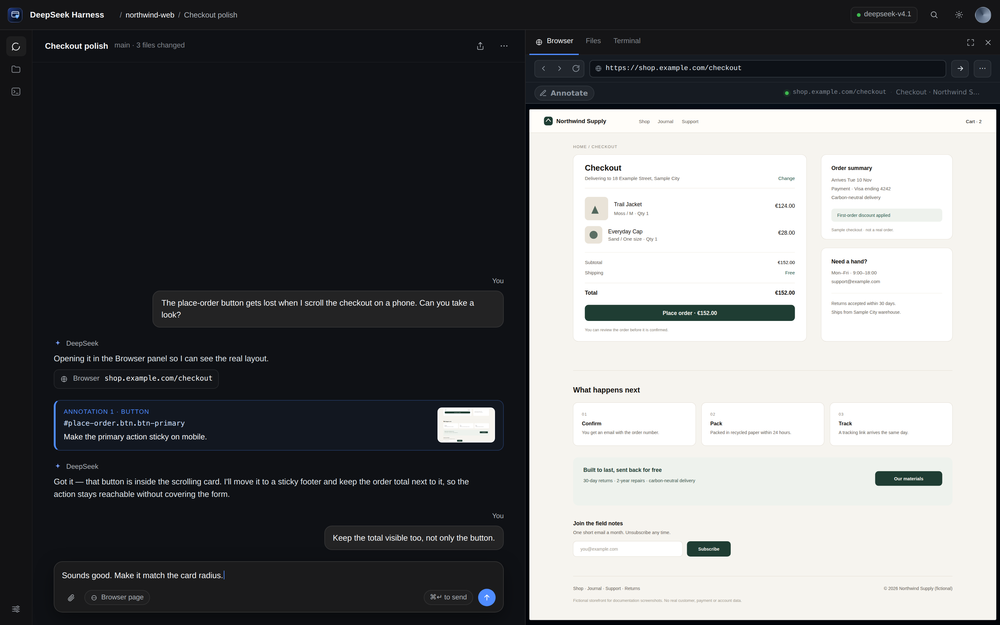
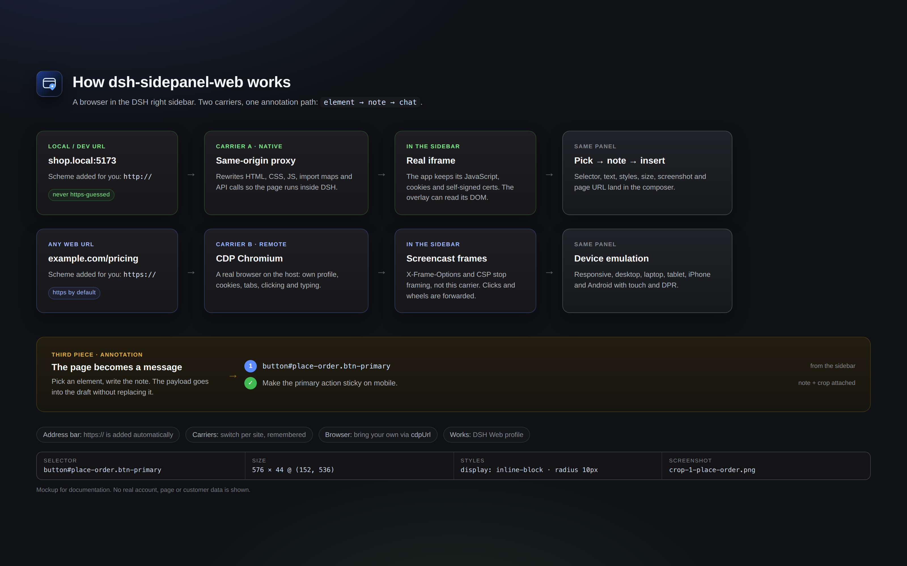
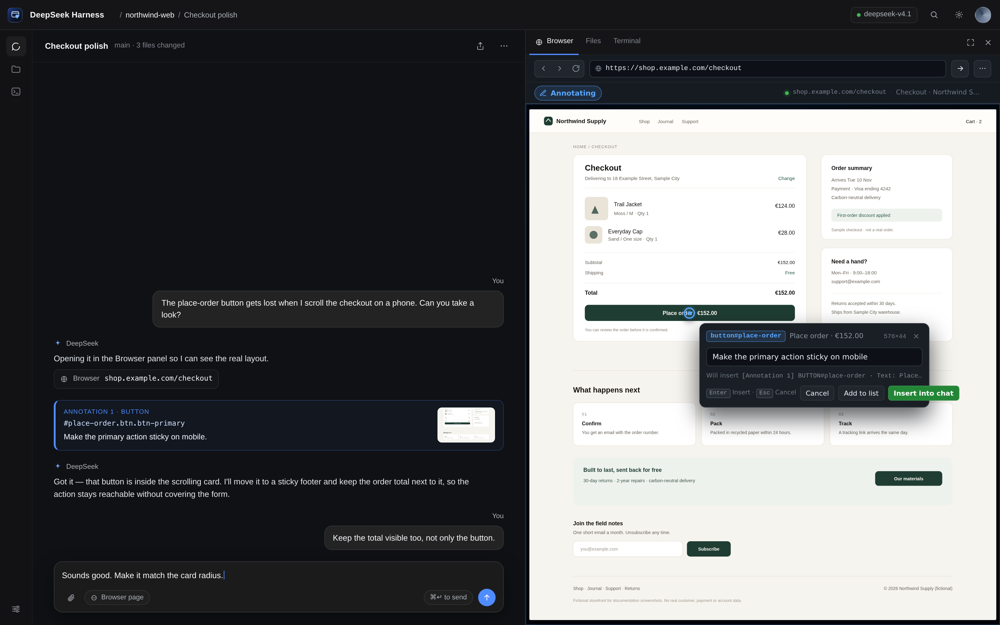
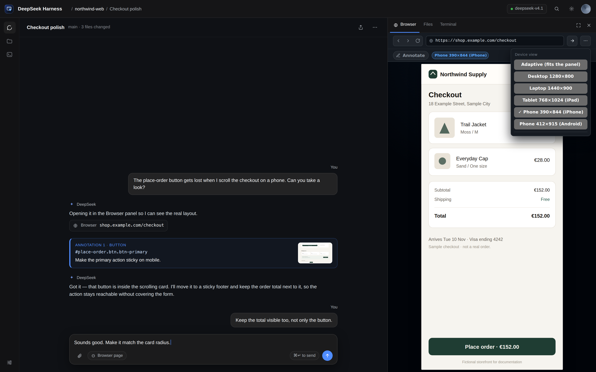

# dsh-sidepanel-web

**A browser in the right sidebar of DeepSeek Harness Web — with element annotations that reach the chat.**

`dsh-sidepanel-web` adds a **Browser** tab to the DSH right sidebar. Local/dev pages are served through a same-origin rewriting proxy, so they render natively, keep their JavaScript and buttons working, and expose their DOM to an annotation overlay. Any other page is rendered by a real Chromium over CDP, so sites that refuse framing work too. Pick an element, write a note, and the annotation lands in the composer as a reference the agent can act on.

> **Status: alpha.** Two carriers (native proxy and CDP), device emulation, an automatic `https://` address bar and chat-link navigation are implemented. The plugin is submitted to the [awesome-dsh-plugin](https://github.com/awesome-dsh-plugin/awesome-dsh-plugin) market ([PR #12641](https://github.com/awesome-dsh-plugin/awesome-dsh-plugin/pull/12641)); see [Market](#market).



*Mockup screenshots. The storefront, conversation and URLs are invented; no real account or customer data is shown. See [Screenshots](#screenshots).*

## Why

Talking about a web page with an agent usually means screenshots, coordinates, and vague descriptions. This panel keeps the page next to the conversation and turns “this button here” into a precise payload: selector, text, classes, styles, position, and a cropped screenshot.

It works in two directions:

- **The pages you are building** — `localhost`, `*.local`, private IPs, dev servers with self-signed certificates — where the DSH host can reach the page even when your browser cannot. These go through the same-origin proxy and stay fully interactive and annotatable.
- **Any public page** — docs, a competitor, a issue tracker, a staging site behind a login. These are rendered by a real Chromium on the host over CDP; `X-Frame-Options` and CSP cannot stop them.

## Features

- **Right-sidebar Browser tab** registered through the official `ctx.sidebarRightTabs` + `sidebar.right.pane.tab` API.
- **Automatic address-bar scheme.** Type `example.com` and the panel opens `https://example.com/`; type `shop.local:5173` or `127.0.0.1:5173` and it uses `http://` instead. Non-web schemes (`mailto:`, `file:`, `javascript:`, `data:`) are refused instead of being turned into a website.
- **Native rendering for local/dev pages** through a rewriting proxy:
  - HTML, CSS, JS, images and API requests stay on the DSH origin.
  - A small shim keeps `fetch`, `XMLHttpRequest`, `history.pushState`/`replaceState` and `window.open` on the proxy.
  - Self-signed certificates are accepted for local hosts.
  - `<script type="importmap">` URLs (imports and scopes) are rewritten too, so ES-module apps keep loading.
  - Only real URL attributes are rewritten: `data-action="family"`-style action names stay untouched.
- **Any public site via CDP screencast.** A real Chromium renders the page on the host and streams frames; clicks, wheel, typing and drags are forwarded. A page cannot be framed when it sends `X-Frame-Options`/`frame-ancestors` — that is why this carrier exists.
- **Chat links land here.** The tab registers `kind: "browser"`, so the chat's “open link in sidebar” preference opens this annotated browser instead of a system tab; `params.url` is navigated on arrival.
- **Device emulation.** Responsive (fits the panel), desktop 1280×800, laptop 1440×900, tablet 768×1024 (iPad UA), phone 390×844 (iPhone UA) and Android 412×915 — real touch emulation and matching `devicePixelRatio`.
- **Switch carrier, any time.** The native view has a *Remote view (CDP)* button and the CDP view offers *Native view (proxy)* for local hosts; the choice is remembered per site. A local app the proxy cannot drive is one click away from the real browser.
- **Bring your own browser.** Point `cdpUrl`/`wsUrl` at any Chrome started with `--remote-debugging-port`; the panel drives that browser, with its cookies and logins. Otherwise it discovers one on the usual ports, or launches its own with a persistent profile.
- **Annotation overlay** injected into the proxied page:
  - Hover inspector: `tag#id.class  240×44  [role]`.
  - Element pick with selector, text, classes, styles, position, HTML excerpt and page URL.
  - Numbered pins, notes, and a crop captured by selector.
- **Composer hand-off**: annotations are inserted with `InputActions.insertText`, so they do not replace the draft.
- **English / Spanish UI** through `ctx.locale`; other locales fall back to English.
- **Host-side Chromium** over CDP: attaches to an existing browser when one is reachable, otherwise auto-detects Chrome/Chromium, falls back to a container-safe launch, and keeps a dedicated profile.

## Requirements

- DSH **0.2.1-rc.2** or newer, below `0.3.0` (Web profile).
- Node.js **22.19+**.
- A Chromium-based browser on the host. The plugin auto-detects Chrome/Chromium; the Playwright Chromium cache also works:

```yaml
- id: dsh-sidepanel-web
  config:
    chromePath: ~/.cache/ms-playwright/chromium-1248/chrome-linux64/chrome
```

To reuse a browser you already run (same cookies and logins), expose its CDP port
and point the plugin at it — no separate install:

```sh
google-chrome --remote-debugging-port=9222 --user-data-dir="$HOME/.config/chrome-dsh" &
```

```yaml
- id: dsh-sidepanel-web
  config:
    cdpUrl: http://127.0.0.1:9222   # or wsUrl: ws://127.0.0.1:9222/devtools/browser/…
```

Chrome 136+ refuses `/json/version` on the default profile, hence the separate
`--user-data-dir`. Without `cdpUrl`/`wsUrl` the plugin probes 9222–9225 and 9333,
then `~/.local/state/dsh-sidepanel-web/browser.json`, then the ego bridge file.

## Install

From GitHub:

```bash
dsh plugin --profile web add github:AleixRocal/dsh-sidepanel-web
```

From a local clone while developing:

```bash
git clone https://github.com/AleixRocal/dsh-sidepanel-web
dsh plugin --profile web add link:/absolute/path/to/dsh-sidepanel-web
```

Then restart `dsh web` once and refresh the GUI. The Browser tab appears in the right-sidebar guide.

## Configuration

Set options in the profile patch, under the plugin's row:

```yaml
# ~/.dsh/profiles/web/cordis.patch.yml
- id: dsh-sidepanel-web
  config:
    chromePath: /path/to/chrome
    headless: true
```

| Key | Default | Meaning |
| --- | --- | --- |
| `chromePath` | auto-detect | Absolute path to a Chromium-based browser. |
| `headless` | `true` | Launch the host browser without a window. |
| `autoLaunch` | `true` | Start a browser when no CDP endpoint is available. |
| `wsUrl` | empty | Explicit CDP endpoint (`ws://127.0.0.1:port/devtools/browser/…`). |
| `cdpUrl` | empty | HTTP debugging endpoint of an existing browser, e.g. `http://127.0.0.1:9222`; resolved through `/json/version`. |
| `profileDir` | `~/.local/share/dsh-sidepanel-web/profile` | Browser profile directory (persistent: logins survive restarts). |
| `homeUrl` | `https://www.deepseek.com` | First page when the browser starts. |
| `device` | `responsive` | Emulation preset: `responsive`, `desktop`, `laptop`, `tablet`, `mobile`, `android`. |
| `pollMs` | `1200` | Screenshot polling interval for the legacy stream mode. |
| `quality` | `82` | JPEG quality for the legacy stream mode. |
| `streamMode` | `screencast` | `screencast` or `poll` (legacy stream mode). |
| `streamFps` | `15` | Frame-rate cap for the legacy stream mode. |

## Usage

1. Open a session, expand the right sidebar, and choose **Browser**.
2. Enter a URL in the address bar.
   - `example.com` → the panel opens `https://example.com/` (scheme added for you).
   - `localhost:3000`, `shop.local`, `192.168.1.20:8080` → `http://` is used for local/dev hosts, which rarely have TLS.
   - **Local/dev host**: the page is proxied through DSH and is fully interactive.
   - **Public host**: the page is rendered by the host Chromium and streamed into the panel. Use **Native view** only for local sites.
3. Click **Annotate** (or the annotate toggle) and hover the page. The inspector shows the element type and size.
4. Click the element, write the note, and choose **Add to list**.
5. Choose **Insert** to place the annotations in the composer; send the message.

Each annotation looks like this:

```text
[Annotation 1] button#save.primary
· Selector: #save
· Text: Save changes
· Styles: display=inline-block; position=static; color=rgb(255, 255, 255); …
· Position: 132×40 @ (24, 680)
· Page: Settings https://localhost:5173/settings
· Note: Make this primary action sticky on mobile
· Screenshot: ~/.dsh/data/dsh-sidepanel-web/crops/…
```

## Architecture



```text
DSH Web GUI
  └─ Browser tab (sidebar.right.pane.tab)
       ├─ Carrier A · native (local/dev)
       │    proxy iframe ──► /api/sidepanel-web/p/<origin>/<path>
       │                         └─ rewriting proxy (HTML/CSS/JS/API)
       │                              └─ overlay: element pick → note → crop
       └─ Carrier B · remote (any page)
            CDP Chromium (host) ──► screencast frames + forwarded input
                 └─ same panel, same annotation flow

  annotations ──► composer (InputActions.insertText)
```

- **Host half** (`lib/index.js`, `lib/service.js`, `lib/cdp.js`, `lib/launcher.js`): routes, Chromium lifecycle, CDP, screenshots, crops.
- **Proxy** (`lib/proxy.js`): fetches local/dev pages, rewrites URLs, injects the shim and overlay, keeps a per-origin cookie jar.
- **Page/overlay** (`lib/page.js`): rendered-page carrier and the annotation overlay.
- **URL rules** (`lib/url.js`): scheme detection shared with the client (mirrored inside `lib/client.js` and enforced by `test/url-smoke.mjs`).
- **Client half** (`lib/client.js`): the sidebar tab, address bar, native/remote carriers, annotation note card, composer insertion, EN/ES dictionaries.

A deeper write-up of the DSH Web integration (slots, tab registry, carriers, browser discovery) is in [`docs/browser-integration.md`](docs/browser-integration.md) (Catalan).

## Security

- Every host route calls `connection.requestRejection(req)`; the web server is loopback-bound.
- The rewriting proxy only accepts **local/dev hosts** (localhost, `*.local`, private, loopback and link-local ranges). Public URLs are refused: the CDP carrier handles those instead.
- The iframe runs sandboxed (`allow-scripts allow-forms allow-same-origin allow-popups` for local proxy pages). `allow-same-origin` is required for the proxy document to keep its cookies and APIs; it also means a proxied page shares the DSH origin. Only proxy pages you trust.
- The host browser uses a dedicated profile and ignores certificate errors for local self-signed dev servers.
- Annotation text and page content are treated as untrusted data by the agent.

## Known limitations

- **Web only.** DSH Desktop uses Electron `<webview>` and a different profile; this plugin does not replace it.
- **The proxy is local/dev only.** Public sites are not proxied; they run in the CDP browser.
- **WebSocket/HMR is not proxied** in the native carrier. Dev servers still serve the page, but hot reload may not work; switch to the CDP view for HMR.
- **Cookies** in the native carrier live in a per-origin host jar; some login flows may still fail. The CDP carrier uses the browser's own profile.
- **Cross-origin iframes and closed shadow DOM** cannot be annotated; only their container.
- **Crops** are taken by selector on the host page; a dynamic page state can differ from the frame you saw.
- **CDP latency** depends on the host and the page; the screencast caps at 15 fps by default.
- **Alpha:** APIs and behaviour may change.

## Development

```text
lib/
  index.js        host plugin: routes, settings, proxy registration
  service.js      CDP service: status, navigation, screenshots, elementAt, crop
  cdp.js          zero-dependency CDP client
  launcher.js     Chromium discovery/launch (container-safe, cert errors ignored)
  page.js         rendered-page carrier + annotation overlay
  proxy.js        local/dev rewriting reverse proxy
  url.js          address-bar normalisation (mirrored in client.js)
  client.js       sidebar tab, carriers, overlay bridge, composer
assets/           icon.svg, icon.png, icon-180.png, screenshots/
test/             smoke tests and the preview/mockup harness
docs/             DSH Web integration research (Catalan)
```

```bash
npm run check          # node --check on every source file
npm test               # URL rules + proxy rewrite smoke tests
npm run smoke          # host CDP smoke test (needs Chromium)
npm run mockups        # re-render assets/screenshots (needs Chromium)
dsh plugin --profile web add link:$PWD
```

The preview harness renders the real `lib/client.js` with a mock backend:

```bash
node test/preview/server.mjs
# http://127.0.0.1:7788/harness.html?state=ready&w=360&h=780
```

## Screenshots

All four images are mockups generated from [`test/preview/shell.html`](test/preview/shell.html) and [`test/preview/diagram.html`](test/preview/diagram.html):

- the panel is the **real** `lib/client.js` running against the mock backend;
- the storefront is **Northwind Supply**, an invented shop on the reserved `example.com` domain;
- the conversation, session name and workspace are invented;
- no screenshot of a real DSH window, account, page, customer, file path or token is used.

The image list is declared in [`screenshots.json`](screenshots.json), which is what plugin storefronts read.

| | |
|---|---|
|  |  |

## Market

The [awesome-dsh-plugin](https://github.com/awesome-dsh-plugin/awesome-dsh-plugin) registry is the market source. Submission state:

- [x] Repository is public and `dsh-plugin` topic is set.
- [x] `package.json` declares `dsh.bundle` and ships [`cordis.patch.yml`](cordis.patch.yml).
- [x] Raster icon at `assets/icon-180.png` and storefront screenshots in [`screenshots.json`](screenshots.json).
- [x] Entry drafted at [`market/entry.yml`](market/entry.yml).
- [x] Pull request opened: [awesome-dsh-plugin#12641](https://github.com/awesome-dsh-plugin/awesome-dsh-plugin/pull/12641) — one file, `data/plugins/AleixRocal__dsh-sidepanel-web.yml`.

The registry validates the repository age (≥ 1 day) and re-runs stale gates automatically, so an early PR is held, not rejected. This repository crossed its first day on 2026-11-06 at 15:45 UTC; until then the submission gate may report the age check as pending.

## License

MIT. See [LICENSE](LICENSE); the original copyright notice is preserved.

---

## Català

**Un navegador al panell dret de DSH Web, amb anotacions que arriben al xat.**

- Escriu `example.com` i s'obre `https://example.com/`; escriu `shop.local:5173` o `127.0.0.1:5173` i fa servir `http://`. Els esquemes que no són web (`mailto:`, `file:`, `javascript:`) es rebutgen.
- Els llocs **locals/dev** (`localhost`, `*.local`, IP privades) passen per un proxy same-origin: es veuen natius, els botons funcionen i l'overlay pot llegir el DOM.
- Els llocs **públics** es renderitzen amb un Chromium real al host via CDP: `X-Frame-Options` i CSP no els aturen, i es poden clicar i anotar igualment.
- En mode **Annotate**, passa el ratolí per sobre (et diu `tag#id.class  240×44`), clica l'element, escriu la nota i insereix-la al composer.
- La UI és en **anglès o castellà** segons l'idioma del perfil; la resta cau a anglès.

Les imatges són **mockups** amb contingut inventat (botiga i xat ficticis, domini `example.com`): no mostren cap compte, pàgina ni dada real. Es regeneren amb `npm run mockups`.
