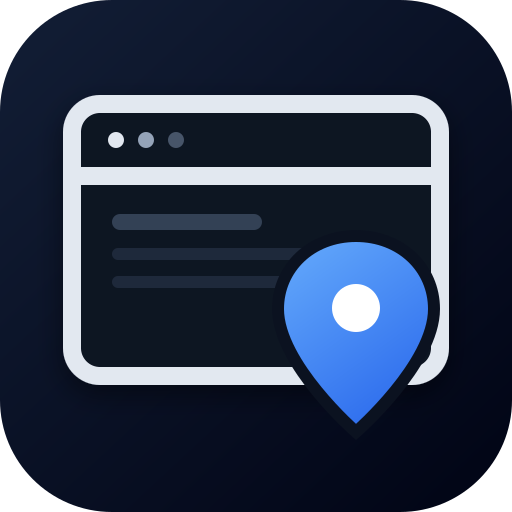

# dsh-sidepanel-web

**A browser in the right sidebar of DeepSeek Harness Web — with element annotations that reach the chat.**

`dsh-sidepanel-web` adds a **Browser** tab to the DSH right sidebar. Local/dev pages are served through a same-origin rewriting proxy, so they render natively, keep their JavaScript and buttons working, and expose their DOM to an annotation overlay. Pick an element, write a note, and the annotation lands in the composer as a reference the agent can act on.

> **Status: alpha.** The local/dev proxy is implemented and tested against a Next.js app over a self-signed certificate. Public sites use a live iframe when the site allows framing. The plugin is not yet listed in the market; see [Market checklist](#market-checklist).



## Why

Talking about a web page with an agent usually means screenshots, coordinates, and vague descriptions. This panel keeps the page next to the conversation and turns “this button here” into a precise payload: selector, text, classes, styles, position, and a cropped screenshot.

It is designed for the pages you are actually building — `localhost`, `*.local`, private IPs, dev servers with self-signed certificates — where the DSH host can reach the page even when your browser cannot.

## Features

- **Right-sidebar Browser tab** registered through the official `ctx.sidebarRightTabs` + `sidebar.right.pane.tab` API.
- **Native rendering for local/dev pages** through a rewriting proxy:
  - HTML, CSS, JS, images and API requests stay on the DSH origin.
  - A small shim keeps `fetch`, `XMLHttpRequest`, `history.pushState`/`replaceState` and `window.open` on the proxy.
  - Self-signed certificates are accepted for local hosts.
- **Live iframe for public pages** when the site allows embedding. Sites that send `X-Frame-Options`/`frame-ancestors` cannot be embedded by any web page; open those in the system browser.
- **Annotation overlay** injected into the proxied page:
  - Hover inspector: `tag#id.class  240×44  [role]`.
  - Element pick with selector, text, classes, styles, position, HTML excerpt and page URL.
  - Numbered pins, notes, and a crop captured by selector.
- **Composer hand-off**: annotations are inserted with `InputActions.insertText`, so they do not replace the draft.
- **English / Spanish UI** through `ctx.locale`; other locales fall back to English.
- **Host-side Chromium** over CDP: auto-detects Chrome/Chromium, falls back to a container-safe launch, and keeps a dedicated profile.

## Requirements

- DSH **0.2.1-rc.2** or newer, below `0.3.0` (Web profile).
- Node.js **22.19+**.
- A Chromium-based browser on the host. The plugin auto-detects Chrome/Chromium; the Playwright Chromium cache also works:

```yaml
- id: dsh-sidepanel-web
  config:
    chromePath: /home/user/.cache/ms-playwright/chromium-1248/chrome-linux64/chrome
```

## Install

From a GitHub checkout:

```bash
dsh plugin --profile web add github:AleixRocal/dsh-sidepanel-web
```

From a local clone while developing:

```bash
git clone https://github.com/AleixRocal/dsh-sidepanel-web
dsh plugin --profile web add link:/absolute/path/to/dsh-sidepanel-web
```

Then restart `dsh web` once and refresh the GUI. The Browser tab appears in the right-sidebar guide.

> The repository is currently **private**. GitHub installs require an authenticated `gh`/git session with access. The npm package is not published.

## Configuration

Set options in the profile patch, under the plugin's row:

```yaml
# ~/.dsh/profiles/web/cordis.patch.yml
- id: dsh-sidepanel-web
  config:
    chromePath: /path/to/chrome
    headless: true
```

| Key | Default | Meaning |
| --- | --- | --- |
| `chromePath` | auto-detect | Absolute path to a Chromium-based browser. |
| `headless` | `true` | Launch the host browser without a window. |
| `autoLaunch` | `true` | Start a browser when no CDP endpoint is available. |
| `wsUrl` | empty | Explicit CDP endpoint (`ws://127.0.0.1:port/devtools/browser/…`). |
| `profileDir` | `~/.local/share/dsh-annotate-browser/profile` | Browser profile directory. |
| `homeUrl` | `https://www.deepseek.com` | First page when the browser starts. |
| `pollMs` | `1200` | Screenshot polling interval for the legacy stream mode. |
| `quality` | `82` | JPEG quality for the legacy stream mode. |
| `streamMode` | `screencast` | `screencast` or `poll` (legacy stream mode). |
| `streamFps` | `15` | Frame-rate cap for the legacy stream mode. |

## Usage

1. Open a session, expand the right sidebar, and choose **Browser**.
2. Enter a URL in the address bar.
   - **Local/dev host** (`localhost`, `*.local`, private IP): the page is proxied through DSH and is fully interactive.
   - **Public host**: the page loads in a live iframe if it allows framing; otherwise use **Open in system browser**.
3. Click **Annotate** (or the annotate toggle) and hover the page. The inspector shows the element type and size.
4. Click the element, write the note, and choose **Add to list**.
5. Choose **Insert** to place the annotations in the composer; send the message.

Each annotation looks like this:

```text
[Annotation 1] button#save.primary
· Selector: #save
· Text: Save changes
· Styles: display=inline-block; position=static; color=rgb(255, 255, 255); …
· Position: 132×40 @ (24, 680)
· Page: Settings https://localhost:5173/settings
· Note: Make this primary action sticky on mobile
· Screenshot: /home/user/.dsh/data/dsh-annotate-browser/crops/…
```

## Architecture

```text
DSH Web GUI
  └─ Browser tab (sidebar.right.pane.tab)
       ├─ Live iframe  ───────────────► public URL (if framing allowed)
       └─ Proxy iframe ──► /api/sidepanel-web/p/<origin>/<path>
                              └─ rewriting proxy (HTML/CSS/JS/API)
                                   └─ CDP Chromium (host)
                                        └─ target page

  annotation overlay (injected into the proxied page)
       └─ postMessage ──► panel ──► composer (InputActions.insertText)
```

- **Host half** (`lib/index.js`, `lib/service.js`, `lib/cdp.js`, `lib/launcher.js`): routes, Chromium lifecycle, CDP, screenshots, crops.
- **Proxy** (`lib/proxy.js`): fetches local/dev pages, rewrites URLs, injects the shim and overlay, keeps a per-origin cookie jar.
- **Page/overlay** (`lib/page.js`): rendered-page carrier and the annotation overlay.
- **Client half** (`lib/client.js`): the sidebar tab, address bar, live/proxy carriers, annotation note card, composer insertion, EN/ES dictionaries.

## Security

- Every host route calls `connection.requestRejection(req)`; the web server is loopback-bound.
- The rewriting proxy only accepts **local/dev hosts** (localhost, `*.local`, private and link-local ranges). Public URLs are refused.
- The iframe runs sandboxed (`allow-scripts allow-forms allow-same-origin allow-popups` for local proxy pages). `allow-same-origin` is required for the proxy document to keep its cookies and APIs; it also means a proxied page shares the DSH origin. Only proxy pages you trust.
- The host browser uses a dedicated profile and ignores certificate errors for local self-signed dev servers.
- Annotation text and page content are treated as untrusted data by the agent.

## Known limitations

- **Web only.** DSH Desktop uses Electron `<webview>` and a different profile; this plugin does not replace it.
- **Public sites that block framing** (Google, GitHub, most SaaS) cannot be embedded. That is `X-Frame-Options`/CSP, not a plugin bug.
- **The proxy is local/dev only.** Public sites are not proxied.
- **WebSocket/HMR is not proxied.** Dev servers still serve the page, but hot reload may not work.
- **Cookies** are kept in a per-origin host jar; some login flows may still fail.
- **Cross-origin iframes and closed shadow DOM** cannot be annotated; only their container.
- **Crops** are taken by selector from the host's CDP page; a dynamic page state can differ from the live iframe.
- **Alpha:** APIs and behaviour may change. Not listed in the market yet.

## Development

```text
lib/
  index.js        host plugin: routes, settings, proxy registration
  service.js      CDP service: status, navigation, screenshots, elementAt, crop
  cdp.js          zero-dependency CDP client
  launcher.js     Chromium discovery/launch (container-safe, cert errors ignored)
  page.js         rendered-page carrier + annotation overlay
  proxy.js        local/dev rewriting reverse proxy
  client.js       sidebar tab, carriers, overlay bridge, composer
assets/           icon.svg, icon.png, icon-180.png
test/             smoke tests and the preview harness
```

```bash
node --check lib/*.js
npm run smoke          # host CDP smoke test
dsh plugin --profile web add link:$PWD
```

## Market checklist

The [awesome-dsh-plugin](https://github.com/awesome-dsh-plugin/awesome-dsh-plugin) registry is the market source. Before submitting:

- [ ] Make the repository **public** (private repos cannot be listed).
- [ ] Remove `"private": true` from `package.json` and publish to npm, or install from GitHub.
- [ ] Keep `dsh.bundle.patch` and `cordis.patch.yml` (required for `dsh plugin add`).
- [ ] Add the **`dsh-plugin`** topic to the repository.
- [ ] Let the repository be at least **1 day old**.
- [ ] Add `assets/icon-180.png` as the entry icon (GitHub-hosted raster).
- [ ] Open a PR to `awesome-dsh-plugin/awesome-dsh-plugin` adding `data/plugins/AleixRocal__dsh-sidepanel-web.yml`:

```yaml
url: https://github.com/AleixRocal/dsh-sidepanel-web
name: AleixRocal/dsh-sidepanel-web
category: browser
description:
  en: Right-sidebar browser for DSH Web that proxies local/dev pages same-origin and turns element picks into chat annotations.
icon: https://raw.githubusercontent.com/AleixRocal/dsh-sidepanel-web/main/assets/icon-180.png
```

A draft entry is kept at [`market/entry.yml`](market/entry.yml).

## Credits

Forked from [`zengxiaolou/dsh-annotate-browser`](https://github.com/zengxiaolou/dsh-annotate-browser) (MIT): the CDP client, launcher, element picker and crop flow started there. This fork adds the official right-sidebar integration, the local/dev rewriting proxy, the live iframe carrier, the annotation overlay, EN/ES copy and the composer hand-off.

## License

MIT. See [LICENSE](LICENSE); the original copyright notice is preserved.

---

## Català

**Navegador al panell dret de DSH Web amb anotacions que arriben al xat.**

- Els llocs **locals/dev** (`localhost`, `*.local`, IP privades) passen per un proxy same-origin: es veuen natius, els botons funcionen i l'overlay pot llegir el DOM.
- Els llocs **públics** es carreguen en un iframe si el lloc ho permet; si envia `X-Frame-Options`, s'han d'obrir al navegador del sistema.
- En mode **Annotate**, passa el ratolí per sobre (et diu `tag#id.class  240×44`), clica l'element, escriu la nota i insereix-la al composer.
- La UI és en **anglès o castellà** segons l'idioma del perfil; la resta cau a anglès.
