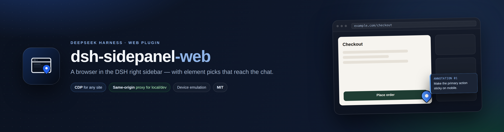
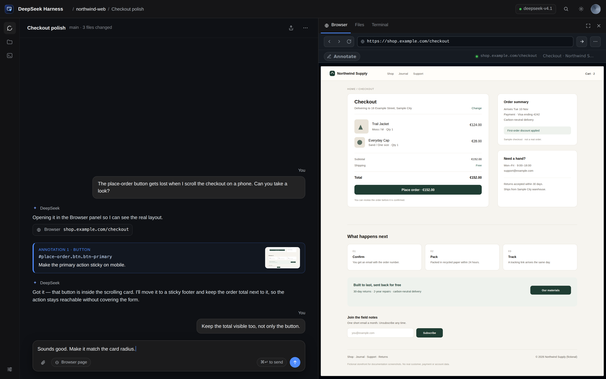
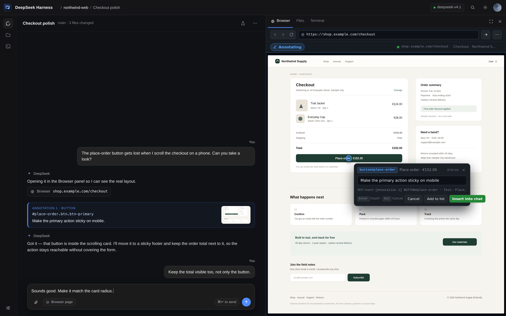
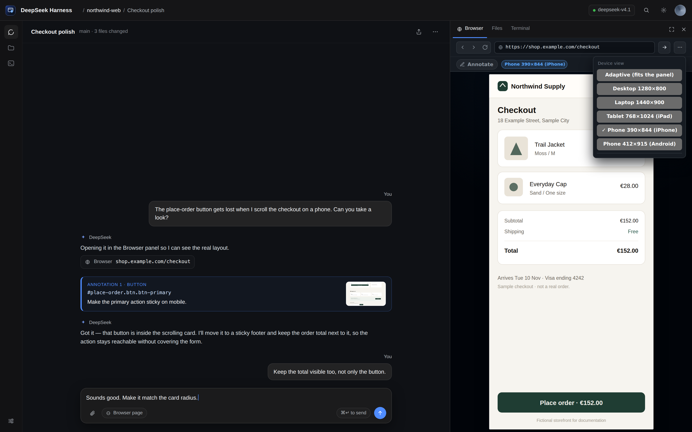
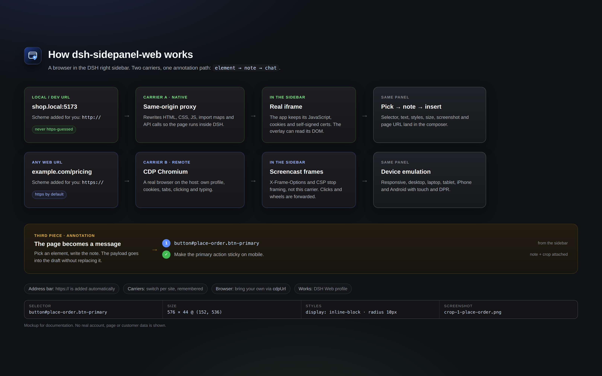

<p align="center">
  
</p>

<p align="center">
  <strong>DSH 右侧边栏里的浏览器 —— 在 DOM 里标注任意页面，把标注送进对话。</strong>
</p>

<p align="center">
  <a href="https://github.com/AleixRocal/dsh-sidepanel-web/actions/workflows/ci.yml"></a>
  <a href="https://github.com/AleixRocal/dsh-sidepanel-web/releases"></a>
  <a href="https://www.npmjs.com/package/dsh-sidepanel-web"></a>
  <a href="https://www.npmjs.com/package/dsh-sidepanel-web"></a>
  <a href="https://github.com/AleixRocal/dsh-sidepanel-web/stargazers"></a>
  <a href="https://github.com/AleixRocal/dsh-sidepanel-web/pkgs/npm/dsh-sidepanel-web"></a>
  <a href="https://github.com/AleixRocal/dsh-sidepanel-web/blob/main/LICENSE"></a>
  
  
  <a href="https://github.com/awesome-dsh-plugin/awesome-dsh-plugin"></a>
</p>

<p align="center">
  <a href="https://github.com/AleixRocal/dsh-sidepanel-web/blob/main/README.md">English</a> · <a href="https://github.com/AleixRocal/dsh-sidepanel-web/blob/main/README.ca.md">Català</a> · 中文
</p>

`dsh-sidepanel-web` 在 DeepSeek Harness Web 的右侧边栏里加了一个 **浏览器** 标签页。它是对话旁边的一个真实浏览器，而且能把页面上的任意元素变成给 agent 的一条精确消息。

选中你正在说的按钮、输入框或卡片，写下要改什么，然后插入。消息里带着元素的 selector、文本、HTML 片段、计算样式、尺寸和位置，以及一张带标注的截图。Agent 不用再猜你指的是哪个元素，你也不用再用坐标或一堆截图去描述它。

**一眼看懂**

- **是什么：** 一个 DSH Web 插件，在右侧边栏添加 **浏览器** 标签页。
- **agent 收到什么：** 元素的 selector、标签、id 和 class、HTML 片段、实际生效的 CSS（计算样式）、尺寸与位置、页面 URL、你的备注，以及一张带标记的截图。
- **为什么有用：** agent 能在代码里找到对应组件并完成修改，而不是靠像素或“下面那个蓝色按钮”去猜。
- **它不做什么：** 不新增 agent 工具，也不自动操作。浏览器和消息仍由你来驱动。

**源码：** [github.com/AleixRocal/dsh-sidepanel-web](https://github.com/AleixRocal/dsh-sidepanel-web) · **npm 包：** [npmjs.com/package/dsh-sidepanel-web](https://www.npmjs.com/package/dsh-sidepanel-web)

> [!TIP]
> **两种载体，一个流程。** 你正在开发的页面 —— `localhost`、`*.local`、私有 IP、带自签名证书的开发服务器 —— 走同源代理，保持完全可交互。公共页面由宿主机上的真实 Chromium 通过 CDP 渲染，所以 `X-Frame-Options` 和 CSP 拦不住它。面板会自动选择；切换只需一次点击。



<p align="center"><em>模拟截图：店铺、对话和 URL 都是虚构的，不包含任何真实账号或客户数据。</em></p>

## 目录

- [怎么用](#怎么用)
- [对话里收到什么](#对话里收到什么)
- [为什么在 DOM 里标注](#为什么在-dom-里标注)
- [两种载体](#两种载体)
- [功能](#功能)
- [快速开始](#快速开始)
- [用法](#用法)
- [配置](#配置)
- [工作原理](#工作原理)
- [常见问题](#常见问题)
- [截图](#截图)
- [截图与隐私](#截图与隐私)
- [安全](#安全)
- [已知限制](#已知限制)
- [开发](#开发)
- [更新日志](https://github.com/AleixRocal/dsh-sidepanel-web/blob/main/CHANGELOG.md)
- [市场](#市场)
- [参与贡献](#参与贡献)
- [致谢](#致谢)
- [许可证](#许可证)

## 怎么用

1. **打开页面。** 展开右侧边栏，选择 **浏览器**。输入 `localhost:5173`、`shop.local` 或 `example.com`：协议会自动补上（本地主机用 `http://`，公共主用 `https://`）。
2. **指向元素。** 点击 **标注**，把鼠标移到页面上，点击你要说的按钮、输入框或卡片。便签卡会显示你选中的内容。写下要改什么：*把这个主操作在移动端做成吸底*、*这个字段应该必填*、*让这张卡片和设计稿一致*。
3. **送进对话。** 选择 **加入列表** 可以继续标注，最后点 **插入**。输入框会收到标注文本和一张带标注的截图。把它发给 agent。

不需要坐标，也不需要说“下面那个蓝色按钮”。标注会说明元素是什么、在哪里，以及你想改什么。

## 对话里收到什么

每条标注是一段文本，后面跟着一张带所有标注钉的图片：

```text
[Annotation 1] button#save.primary
· Selector: #save
· Text: Save changes
· HTML: <button id="save" class="btn primary" type="button">Save changes</button>
· Styles: display=inline-block; position=static; color=rgb(255, 255, 255); background=rgb(37, 99, 235); font=…; padding=12px 20px; radius=8px
· Position: 132×40 @ (24, 680)
· Page: Settings https://localhost:5173/settings
· Note: Make this primary action sticky on mobile
· Screenshot: ~/.dsh/data/dsh-sidepanel-web/crops/…
```

> [!NOTE]
> 示例是英文界面下的 payload。界面切换为西班牙语时，字段标签会变成西班牙语；selector、HTML、样式和位置这些值不变。

- **文本是 agent 能顺着找下去的线索。** 它会收到元素身份（tag、id、class、selector）、一段 HTML、通常最相关的计算样式（display、position、颜色、字体、padding、radius）、元素的尺寸和位置、页面 URL 和标题，以及你的备注。它可以用 selector 和 HTML 在代码里定位组件，用样式和位置推断布局。
- **图片是上下文。** 插入时，宿主机会渲染一张页面视图，给每个 pick 编号、描边。DSH 对单张图片按长边 240 px 显示（同一消息里多张图片则变成 64 px 方块），所以每次插入只发一张图是刻意的：你看到页面、标注钉和它们周围的内容，也可以点开原图看全尺寸。
- **多个 pick，一条消息。** 把需要的元素都加入列表；插入时会发送所有标注文本，外加一张带全部标注钉的图片。

## 为什么在 DOM 里标注

截图告诉你页面长什么样；DOM 标注告诉 agent 这个元素**是什么**。

| 只有截图 | 有 DOM 标注 |
| --- | --- |
| Agent 只看到像素，要猜你指的是哪个元素。 | Agent 拿到 tag、id、class、selector 和一段 HTML。 |
| 你用文字描述位置。 | Agent 拿到计算样式、尺寸和位置。 |
| 视觉上下文清楚。 | 视觉上下文还在，而且带编号标注钉。 |

两者都重要。图片告诉 agent 元素在哪、周围是什么；DOM payload 告诉它元素是什么，于是它能找到代码、做修改、推断布局，而不用来回问“是哪个按钮？”。备注补上意图：你想改什么，而不只是现在有什么。

## 两种载体

面板可以用两种方式渲染页面。通常你不需要关心：选择跟着 URL 走，并按 origin 记住。

| URL | 载体 | 你得到什么 |
| --- | --- | --- |
| `localhost`、`*.localhost`、`*.local`、私有/回环/link-local IP | **原生** —— 同源代理 | 真实页面和 DOM，完全可交互，带标注 overlay；接受自签名证书；Cookie 存在按 origin 分开的罐子里。 |
| 其他任何 `http(s)` 页面 | **远程** —— CDP | 宿主机上的真实 Chromium 渲染页面，帧和输入转发到面板；能绕过 `X-Frame-Options`、CSP，使用浏览器配置里的登录状态。 |

**原生载体。** DSH 拉取页面、重写 URL，并注入一个小 shim 和标注 overlay，让页面与 DSH 同源，可以像普通标签页一样检查和点击。HTML、CSS、JS、图片和 API 调用都走代理；`fetch`、`XMLHttpRequest`、`history.pushState`/`replaceState` 和 `window.open` 留在代理上；`<script type="importmap">` 里的 URL 会被重写；`data-action="family"` 这类动作名不会被改。WebSocket/HMR 不代理。

**远程载体。** 宿主机 Chromium 真正加载页面，把画面帧推送到面板；点击、滚轮、输入和拖拽会被转发。它适合公共站点、拒绝被嵌入的页面，以及需要登录的站点。

**切换。** 原生视图有 **远程视图 (CDP)** 按钮；远程视图提供 **原生视图 (proxy)**（本地主机）和 **强制原生视图（不安全）**（其他 origin），并按 origin 记住。强制把公共页面放进代理会让该页面与 DSH 同源 —— 只对你信任的站点这样做。

## 功能

**边栏里**

- **真实的浏览器标签页**（`kind: "browser"`），对话里的“在侧边栏打开链接”会落到这里；`params.url` 在到达时导航。
- **地址栏自动补协议。** `example.com` 变成 `https://example.com/`；`shop.local:5173`、`127.0.0.1:5173` 或 `192.168.1.20:8080` 用 `http://`。非 Web 协议（`mailto:`、`file:`、`javascript:`、`data:`）会被拒绝。
- **自带浏览器。** 把 `cdpUrl`/`wsUrl` 指向任何开了 `--remote-debugging-port` 的 Chrome，或让插件自动发现，或让它启动一个带持久配置的浏览器。
- **设备模拟。** 响应式（贴合面板）、桌面 1280×800、笔记本 1440×900、平板 768×1024（iPad UA）、手机 390×844（iPhone UA）和 Android 412×915，带触摸和匹配的 `devicePixelRatio`。
- **英文和西班牙文界面**，通过 `ctx.locale`；其他语言回退到英文。

**标注**

- **悬停检查器：** `tag#id.class  240×44  [role]`，先看清再选。
- **元素选择**，带 selector、文本、class、HTML 片段、计算样式、尺寸/位置和页面 URL。
- **编号标注钉和备注。** 可以把多个 pick 放进列表，一起插入。
- **输入框交接**，用 `InputActions.insertText` 在光标处插入，不覆盖你的草稿。
- **每次插入一张带标注的图片**，所有 pick 都带钉 —— 不是每个元素一张小裁图。
- **Esc 退出标注模式**，从页面或工具栏都行；有打开的便签卡时先关卡片。

## 快速开始

### 要求

- DSH **0.2.1-rc.2** 或更高，低于 `0.3.0`（Web profile）。
- Node.js **22.19+**。
- 宿主机上有基于 Chromium 的浏览器。插件会自动检测 Chrome/Chromium；Playwright 的 Chromium 缓存也可以。

### 安装

```bash
# 从 npm
dsh plugin --profile web add dsh-sidepanel-web

# 从 GitHub
dsh plugin --profile web add github:AleixRocal/dsh-sidepanel-web

# 或从本地克隆，开发时用
git clone https://github.com/AleixRocal/dsh-sidepanel-web
dsh plugin --profile web add link:/absolute/path/to/dsh-sidepanel-web
```

重启一次 `dsh web` 并刷新 GUI。右侧边栏的引导里会出现 **浏览器** 标签页。

带 scope 的副本（`@aleixrocal/dsh-sidepanel-web`）也发布在 [GitHub Packages](https://github.com/AleixRocal/dsh-sidepanel-web/pkgs/npm/dsh-sidepanel-web)；规范包仍然是 npmjs 上的那个。安装镜像需要带 `read:packages` 的 token 和 `@aleixrocal:registry=https://npm.pkg.github.com`。

### 第一个页面

1. 展开右侧边栏，选择 **浏览器**。
2. 输入 `example.com` 并回车。面板打开 `https://example.com/`；协议自动补上。
3. 点击 **标注**，悬停页面，点击一个元素，写备注，选择 **插入**。

> [!NOTE]
> 如果在常见 CDP 端口上没找到浏览器，插件会启动一个带持久配置的专用无头 Chromium。只有自动检测不到时才需要设置 `chromePath`。

### 使用你自己的浏览器

想复用你已经在用的浏览器（同样的 Cookie 和登录状态），暴露它的 CDP 端口并让插件连过去 —— 不需要另外安装：

```sh
google-chrome --remote-debugging-port=9222 --user-data-dir="$HOME/.config/chrome-dsh" &
```

```yaml
- id: dsh-sidepanel-web
  config:
    cdpUrl: http://127.0.0.1:9222   # 或 wsUrl: ws://127.0.0.1:9222/devtools/browser/…
```

Chrome 136+ 不允许默认配置暴露 `/json/version`，所以要单独给一个 `--user-data-dir`。没有 `cdpUrl`/`wsUrl` 时，插件会探测 9222–9225 和 9333，然后读 `~/.local/state/dsh-sidepanel-web/browser.json`，最后读 ego 桥接文件。

## 用法

1. 打开一个会话，展开右侧边栏，选择 **浏览器**。
2. 在地址栏输入 URL。
   - `example.com` → `https://example.com/`（自动补协议）。
   - `localhost:3000`、`shop.local`、`192.168.1.20:8080` → `http://`，因为开发服务器很少配 TLS。
   - 本地/开发主机会走 DSH 的代理，保持完全可交互；公共主机会由宿主机 Chromium 渲染并推流到面板。
3. 点击 **标注** 并悬停页面。检查器显示元素类型和尺寸。
4. 点击元素，写备注，选择 **加入列表**。对每个想包含的元素重复。
5. 选择 **插入**，把标注和带标注的图片放进输入框；发送消息。
6. 用 **⋯** 菜单选择设备预设、清除标注钉，或在 **原生视图 (proxy)** 和 **远程视图 (CDP)** 之间切换。选择按 origin 记住。

| URL | 载体 | 为什么 |
| --- | --- | --- |
| `example.com`、任何公共站点 | CDP screencast | 即使站点发送 `X-Frame-Options`/CSP 也能用。 |
| `localhost`、`*.local`、私有/回环/link-local IP | 同源代理 | 原生渲染、可访问 DOM、无需 screencast 即可标注。 |

## 配置

在 profile patch 里、插件那一行下面设置：

```yaml
# ~/.dsh/profiles/web/cordis.patch.yml
- id: dsh-sidepanel-web
  config:
    chromePath: /path/to/chrome
    headless: true
```

| 键 | 默认值 | 含义 |
| --- | --- | --- |
| `chromePath` | 自动检测 | 基于 Chromium 的浏览器的绝对路径。 |
| `headless` | `true` | 不显示窗口启动宿主机浏览器。 |
| `autoLaunch` | `true` | 没有可用 CDP endpoint 时启动浏览器。 |
| `wsUrl` | 空 | 显式 CDP endpoint（`ws://127.0.0.1:port/devtools/browser/…`）。 |
| `cdpUrl` | 空 | 已有浏览器的 HTTP 调试 endpoint，例如 `http://127.0.0.1:9222`；通过 `/json/version` 解析。 |
| `profileDir` | `~/.local/share/dsh-sidepanel-web/profile` | 浏览器配置目录（持久：登录状态在重启后保留）。 |
| `homeUrl` | `https://www.deepseek.com` | 浏览器启动时的第一页。 |
| `device` | `responsive` | 模拟预设：`responsive`、`desktop`、`laptop`、`tablet`、`mobile`、`android`。 |
| `pollMs` | `1200` | 旧版 stream 模式的截图轮询间隔。 |
| `quality` | `82` | 旧版 stream 模式的 JPEG 质量。 |
| `streamMode` | `screencast` | `screencast` 或 `poll`（旧版 stream 模式）。 |
| `streamFps` | `15` | 旧版 stream 模式的帧率上限。 |

## 工作原理

```text
DSH Web GUI
  └─ 浏览器标签页 (sidebar.right.pane.tab)
       ├─ 载体 A · 原生（本地/开发）
       │    代理 iframe ──► /api/sidepanel-web/p/<origin>/<path>
       │                       └─ 重写代理（HTML/CSS/JS/API）
       │                            └─ overlay：选择 → 备注 → 合成图片
       └─ 载体 B · 远程（任意页面）
            CDP Chromium（宿主机）──► 画面帧 + 转发的输入
                 └─ 同一个面板，同一套标注流程

  标注 + 一张带标注钉的截图 ──► 输入框（InputActions.insertText）
```

**宿主半** 拥有 Chromium、代理、截图和合成渲染；**客户端半** 是你看到的标签页。原生载体让页面保持同源，这样 overlay 能读 DOM、你也能点击；远程载体推流真实浏览器并转发输入。两者喂给同一套标注 payload，所以对话不关心你用了哪个载体。

点击 **插入** 时，宿主机渲染一张页面视图，重新给每个 pick 打钉（原生页面按 selector，CDP 用当前页面），返回一张 PNG。如果渲染失败，就改附第一个元素的裁图，所以消息始终有一张图和全部文本。

- **宿主半**（`lib/index.js`、`lib/service.js`、`lib/cdp.js`、`lib/launcher.js`）：路由、Chromium 生命周期、CDP、截图、裁图、合成渲染。
- **代理**（`lib/proxy.js`）：拉取本地/开发页面、重写 URL、注入 shim 和 overlay、维护按 origin 的 Cookie 罐。
- **页面/overlay**（`lib/page.js`）：渲染页面载体和标注 overlay。
- **URL 规则**（`lib/url.js`）：地址栏协议检测，客户端里有一份镜像，由 `test/url-smoke.mjs` 校验。
- **客户端半**（`lib/client.js`）：标签页、地址栏、原生/远程载体、便签卡、输入框插入、EN/ES 词典。

更深入的 DSH Web 集成说明（slot、标签页注册、载体、浏览器发现）在 [`docs/browser-integration.md`](https://github.com/AleixRocal/dsh-sidepanel-web/blob/main/docs/browser-integration.md)（加泰罗尼亚语）。

## 常见问题

<details>
<summary><strong>我输入 <code>example.com</code>，它打开了 <code>https://example.com/</code>。能强制用 <code>http://</code> 吗？</strong></summary>

可以 —— 显式写出协议（`http://example.com`）。本地/开发主机（`localhost`、`*.local`、私有、回环和 link-local 地址）默认就用 `http://`，因为开发服务器很少配 TLS。非 Web 协议会被拒绝。
</details>

<details>
<summary><strong>公共页面报连接错误，或者加载不了。</strong></summary>

公共页面走 CDP 载体，不是 iframe，所以 `X-Frame-Options` 不是原因。检查宿主机 Chromium 是否在运行、是否可达（`cdpUrl`/`wsUrl` 或自动启动），以及宿主机能否访问该站点。面板状态栏会显示 CDP 错误。
</details>

<details>
<summary><strong>可以给公共站点强制原生视图吗？</strong></summary>

可以，但要显式操作：打开站点，点 **⋯** 菜单，选择 **强制原生视图（不安全）**。选择按 origin 记住，以后打开该 origin 都会走原生载体，页面会像本地页面一样被代理和标注。只对你信任的站点这样做：被代理的页面与 DSH 同源，能读取面板 DOM，并用你的会话调用 DSH API。默认策略不变 —— 本地/开发走原生，公共走 CDP。
</details>

<details>
<summary><strong>为什么对话里只有一张图，而不是每条标注一张裁图？</strong></summary>

因为 DSH 按图片数量决定尺寸：单独一张图按长边 240 px 显示，且不会放大到超过原始尺寸；同一消息里多张图会变成 64 px 方块。小按钮的裁图在两种情况下都会显得很小。所以插入时发送一张带全部标注钉的页面视图，而每个元素的裁图路径仍保留在文本里。
</details>

<details>
<summary><strong>本地页面在原生视图里是空白的。</strong></summary>

重写代理能应付大多数应用，但 WebSocket/HMR 不被代理，一些重度 JavaScript 应用需要真实浏览器。对这个站点使用 **远程视图 (CDP)**；选择会按 origin 记住。
</details>

<details>
<summary><strong>Chrome 136+ 不再暴露 <code>/json/version</code>。</strong></summary>

用单独的配置启动：`--user-data-dir="$HOME/.config/chrome-dsh"`。从 Chrome 136 起，默认配置受 CDP 保护。
</details>

<details>
<summary><strong>Cookie 和登录状态存在哪里？</strong></summary>

插件自己的 Chromium 使用持久的 `profileDir`（默认 `~/.local/share/dsh-sidepanel-web/profile`）。如果你通过 `cdpUrl`/`wsUrl` 指向自己的浏览器，配置和 Cookie 由那个浏览器保存。
</details>

<details>
<summary><strong>支持 DSH Desktop 吗？</strong></summary>

不支持。这是 Web profile 插件；DSH Desktop 用 Electron `<webview>` 和另一套配置。
</details>

<details>
<summary><strong>能标注跨域 iframe 或 closed shadow DOM 吗？</strong></summary>

只能标注它们的容器。overlay 无法穿透跨域 iframe 或 closed shadow root。
</details>

<details>
<summary><strong>截图是怎么生成的？会用真实数据吗？</strong></summary>

用 `npm run mockups`，从真实客户端和 mock 后端生成。所有图片都用虚构内容（虚构店铺、保留域名 `example.com`、虚构对话）；不会截取任何真实 DSH 窗口、账号、客户、文件路径或 token。见 [截图与隐私](#截图与隐私)。
</details>

## 截图

| | |
| --- | --- |
|  |  |
| **选择、备注、发送。** 标注钉落在元素上，便签卡准备输入框 payload。 | **设备模拟。** 桌面、笔记本、平板、iPhone 和 Android，带触摸和 DPR。 |



<p align="center"><em>示意图：本地/开发页面走同源代理，公共页面走 CDP，最后喂给同一套标注 payload。</em></p>

所有截图都是用 [`test/preview/shell.html`](https://github.com/AleixRocal/dsh-sidepanel-web/blob/main/test/preview/shell.html) 和 [`test/preview/diagram.html`](https://github.com/AleixRocal/dsh-sidepanel-web/blob/main/test/preview/diagram.html) 生成的模拟图：面板是真实客户端，店铺是保留域名 `example.com` 上的虚构 **Northwind Supply**，没有使用任何真实账号、页面或客户数据。见 [截图与隐私](#截图与隐私)。

## 截图与隐私

截图是交付物的一部分，所以遵守一条硬规则：**不使用任何真实用户数据**。

- 面板是真实的 `lib/client.js`；周围的外壳（对话、工作区、会话）是 [`test/preview/shell.html`](https://github.com/AleixRocal/dsh-sidepanel-web/blob/main/test/preview/shell.html) 里的静态 HTML。
- 店铺是 **Northwind Supply**，保留域名 `example.com` 上的虚构商店。
- 任何图片里都没有真实 DSH 窗口、账号、页面、客户、文件路径或 token。
- [`screenshots.json`](https://github.com/AleixRocal/dsh-sidepanel-web/blob/main/screenshots.json) 为插件市场声明了四张店铺图片。
- 用 `npm run mockups` 重新生成；banner 由 [`test/preview/banner.html`](https://github.com/AleixRocal/dsh-sidepanel-web/blob/main/test/preview/banner.html) 渲染。

## 安全

- 宿主机的每条路由都会调用 `connection.requestRejection(req)`；Web 服务器绑定在回环地址。
- 重写代理默认只接受 **本地/开发主机**（localhost、`*.local`、私有、回环和 link-local 范围）。公共 URL 会被拒绝，交给 CDP 载体 —— 除非该 origin 被显式强制到原生视图。
- 原生 iframe 在 sandbox 里运行（本地代理页面用 `allow-scripts allow-forms allow-same-origin allow-popups`）。`allow-same-origin` 是代理文档保留 Cookie 和 API 所必需的；这也意味着被代理页面与 DSH 同源。只代理你信任的页面。
- **强制原生视图是显式覆盖。** 它让公共 origin 走同源代理；该页面因而与 DSH 同源（DOM、Cookie、API 调用）。默认策略仍然拒绝公共主机。只强制你信任的站点。
- 宿主机浏览器使用专用配置，并忽略证书错误（本地自签名开发服务器需要）。CDP 载体拥有你指向的浏览器的能力。
- 标注文本和页面内容对 agent 来说是不可信数据。
- 通过 [SECURITY.md](https://github.com/AleixRocal/dsh-sidepanel-web/blob/main/SECURITY.md) 私下报告漏洞；不要开公开 issue。

## 已知限制

- **仅限 Web。** DSH Desktop 使用 Electron `<webview>` 和另一套配置；这个插件不能替代它。
- **代理默认只支持本地/开发。** 公共站点不代理，走 CDP 浏览器。**强制原生视图** 是按 origin 的显式覆盖，带上面的同源警告。
- **WebSocket/HMR 不被代理**（原生载体）。开发服务器仍能提供页面，但热更新可能不工作；需要时切到 CDP 视图。
- **Cookie** 在原生载体里按 origin 存在宿主机罐子中；某些登录流程仍可能失败。CDP 载体使用浏览器自己的配置。
- **跨域 iframe 和 closed shadow DOM** 不能标注；只能标注容器。
- **带标注的图片是宿主机上的重新渲染**（1200 px 宽的视口，会按 picks 增长；或者当前 CDP 页面），所以只存在于面板里的状态 —— 打开的 modal、填了一半的表单 —— 可能不会出现。文本保留每个 pick、它的 HTML 片段和裁图路径。
- **CDP 延迟** 取决于宿主机和页面；screencast 默认上限 15 fps。
- **Alpha：** API 和行为可能变化。

## 开发

```text
lib/
  index.js        宿主插件：路由、设置、代理注册
  service.js      CDP 服务：状态、导航、截图、裁图、合成
  cdp.js          零依赖 CDP 客户端
  launcher.js     Chromium 发现/启动（容器安全，忽略证书错误）
  page.js         渲染页面载体 + 标注 overlay
  proxy.js        本地/开发重写反向代理
  url.js          地址栏规范化（client.js 里有镜像）
  client.js       标签页、载体、overlay 桥、输入框
assets/           icon.svg、icon.png、icon-180.png、banner.png、screenshots/
test/             smoke 测试和 preview/mockup harness
docs/             DSH Web 集成研究（加泰罗尼亚语）
```

```bash
npm run check          # 对所有源文件跑 node --check
npm test               # URL 规则 + 代理重写 smoke 测试
npm run test:ui        # Esc、原生命令插入、合成图片附件（需要 Chromium）
npm run test:composite # 真实 Chromium 合成渲染，带标注钉（需要 Chromium）
npm run smoke          # 宿主 CDP smoke 测试（需要 Chromium）
npm run mockups        # 重新生成 assets/banner.png 和 assets/screenshots
dsh plugin --profile web add link:$PWD
```

版本说明在 [`CHANGELOG.md`](https://github.com/AleixRocal/dsh-sidepanel-web/blob/main/CHANGELOG.md)。

preview harness 用 mock 后端渲染真实的 `lib/client.js`：

```bash
node test/preview/server.mjs
# http://127.0.0.1:7788/harness.html?state=ready&w=360&h=780
```

每个状态、全窗口 shell、行为测试和 mockup 流水线见 [`test/preview/README.md`](https://github.com/AleixRocal/dsh-sidepanel-web/blob/main/test/preview/README.md)。

## 市场

已收录到 [awesome-dsh-plugin](https://github.com/awesome-dsh-plugin/awesome-dsh-plugin)（PR [#12641](https://github.com/awesome-dsh-plugin/awesome-dsh-plugin/pull/12641)，2026-11-08 合并）：

- [x] 仓库公开，已设置 `dsh-plugin` topic。
- [x] `package.json` 声明 `dsh.bundle`，并包含 [`cordis.patch.yml`](https://github.com/AleixRocal/dsh-sidepanel-web/blob/main/cordis.patch.yml)。
- [x] 有 `assets/icon-180.png` 光栅图标和 [`screenshots.json`](https://github.com/AleixRocal/dsh-sidepanel-web/blob/main/screenshots.json) 里的店铺截图。
- [x] 条目在 [`market/entry.yml`](https://github.com/AleixRocal/dsh-sidepanel-web/blob/main/market/entry.yml)。
- [x] 已作为 [`dsh-sidepanel-web`](https://www.npmjs.com/package/dsh-sidepanel-web) 发布到 npm。

## 参与贡献

欢迎贡献：bug 报告、载体修复、文档和 mockup 改进。先看 [CONTRIBUTING.md](https://github.com/AleixRocal/dsh-sidepanel-web/blob/main/CONTRIBUTING.md)，跑 `npm run check` 和 `npm test`，添加图片前读一下截图隐私规则。项目遵循 [行为准则](https://github.com/AleixRocal/dsh-sidepanel-web/blob/main/CODE_OF_CONDUCT.md)。安全问题走 [SECURITY.md](https://github.com/AleixRocal/dsh-sidepanel-web/blob/main/SECURITY.md)，不要开公开 issue。

## 致谢

Fork 自 [`zengxiaolou/dsh-annotate-browser`](https://github.com/zengxiaolou/dsh-annotate-browser)（MIT）：CDP 客户端、launcher、元素选择器和裁图流程从那里开始。这个 fork 增加了官方右侧边栏集成、本地/开发重写代理、双载体切换、标注 overlay、设备模拟、EN/ES 文案、合成标注图片和输入框交接。

## 许可证

MIT。见 [LICENSE](https://github.com/AleixRocal/dsh-sidepanel-web/blob/main/LICENSE)；原始版权声明保留。

---

<p align="center"><a href="https://github.com/AleixRocal/dsh-sidepanel-web/blob/main/README.md">English</a> · <a href="https://github.com/AleixRocal/dsh-sidepanel-web/blob/main/README.ca.md">Català</a> · 中文 · <a href="#目录">回到顶部 ↑</a></p>
